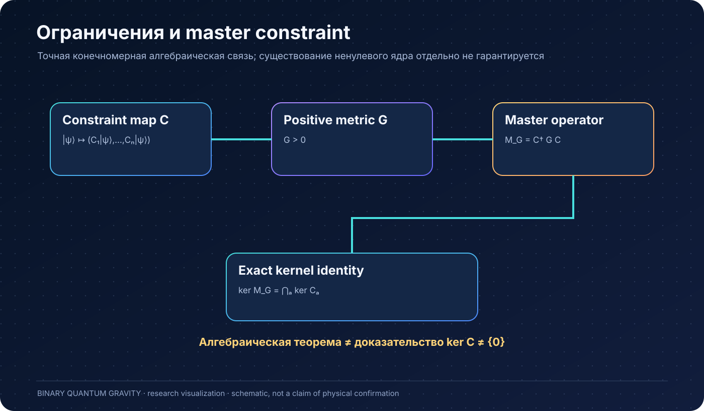
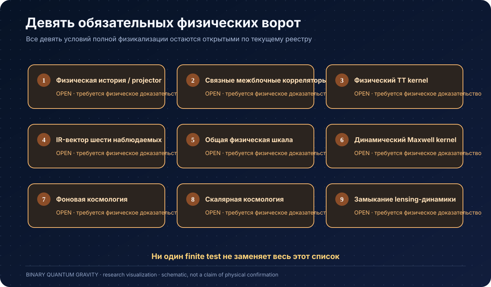

# Master constraint -> finite-regulator physical projector

Status: **exact finite-dimensional operator theorem + implementation target; not yet the continuum physical graviton amplitude.**

This document replaces the deliberately formal lapse-integral arrow in `HAMILTONIAN_CONSTRAINT_TO_EFFECTIVE_ACTION.md` by a sharper fail-closed construction at every finite regulator.

The key point is simple: once a finite regulated set of quantum constraints and the kinematical inner product are fixed, the common solution space can be selected by the zero spectral sector of one positive master constraint.  No constraint spectral parameter is identified with physical time.

---

## 1. Finite regulated constraints

Let the regulated first-class constraints acting on a finite Peter-Weyl habitat be
$$
C_A,\qquad A=1,\ldots,m,
$$
after whatever Gauss/diffeomorphism reduction has explicitly been performed at that stage.

Choose any positive-definite Hermitian matrix `G` on the finite constraint-label space and define
$$
\boxed{
\mathbb M_G
=\sum_{A,B} C_A^\dagger G^{AB}C_B.
}
$$
Equivalently, if `C psi` denotes the column with entries `C_A psi`,
$$
\langle\psi|\mathbb M_G|\psi\rangle
=\lVert G^{1/2}C\psi\rVert^2\ge0.
$$
Therefore
$$
\boxed{
\ker\mathbb M_G
=\bigcap_A\ker C_A
}
$$
for every strictly positive `G`.

**Proof.** If every `C_A psi=0`, then `M_G psi=0`. Conversely, if `M_G psi=0`, positivity gives `G^{1/2}C psi=0`; invertibility of `G^{1/2}` gives every `C_A psi=0`. QED.

Thus the *zero-sector* is independent of the arbitrary positive constraint metric `G`.  `G` changes the nonzero spectrum and hence numerical conditioning/convergence rates, not the exact common kernel.

---

## 2. Exact finite physical projector




At finite regulator, when zero is an isolated eigenvalue, define
$$
\boxed{
P_{\rm phys}^{(\epsilon)}
=\mathbf 1_{\{0\}}(\mathbb M_G).
}
$$
This is an ordinary orthogonal spectral projector and satisfies
$$
P_{\rm phys}^2=P_{\rm phys},\qquad
P_{\rm phys}^\dagger=P_{\rm phys},\qquad
C_A P_{\rm phys}=0.
$$
Equivalent regulated approximants include
$$
P_T=e^{-T\mathbb M_G},\qquad T\to\infty,
$$
and a spectral-window projector
$$
P_\delta=\mathbf 1_{[0,\delta)}(\mathbb M_G)
$$
with `delta` below the first positive eigenvalue.

If the finite gap is
$$
\Delta_M=\min(\operatorname{spec}\mathbb M_G\setminus\{0\}),
$$
then in operator norm
$$
\boxed{
\lVert e^{-T\mathbb M_G}-P_{\rm phys}\rVert
=e^{-T\Delta_M}.
}
$$
This gives an explicit convergence diagnostic rather than an unspecified lapse measure.

---

## 3. What happens when the continuum zero sector is not discrete

The finite spectral projector is not automatically the continuum rigging map.

Under regulator removal the zero eigenvalue can merge into continuous spectrum or the finite gap can close.  Then one must define a normalized spectral/rigging limit, for example through controlled windows or heat kernels, and demonstrate convergence of physical matrix elements.

Hence the legal chain is

```text
finite constraints C_A^(epsilon)
 -> positive master constraint M_epsilon
 -> exact finite zero-sector projector / heat-kernel family
 -> refinement comparison of normalized physical matrix elements
 -> rigging-map / physical-inner-product limit, if it exists.
```

The continuum limit remains a scientific gate.

---

## 4. Why this is preferable to a naive group average here

The Hamiltonian constraints of gravity realize the hypersurface-deformation structure with phase-space-dependent structure functions rather than a fixed finite-dimensional Lie algebra.

The repository therefore does **not** assume that a naive Haar group average over lapses is already mathematically defined.

The master-constraint construction packages the common constraint surface into one positive spectral problem while keeping the already-frozen HDA calculation as an independent consistency test of the underlying constraint family.

This is aligned with the master-constraint programme in canonical loop quantum gravity, where the construction was introduced precisely to handle difficulties of the non-Lie Dirac algebra and a self-adjoint master operator was used to define the physical Hilbert space spectrally.

The repository does not inherit any claim from that literature automatically; it uses only the finite operator theorem above unless its own continuum limit is demonstrated.

---

## 5. Source-deformed physical boundary amplitude

The projector solves the constraint-selection problem, but a graviton two-point function still needs physical boundary data and derived metric insertions.

Let `O_g` be the coarse metric observable supplied by the exact logical-shape -> metric map and its multi-block extension.

For physical/semi-classical boundary states define a source-deformed amplitude schematically as
$$
Z[J]
=\langle\Psi_{out}|\,
P_{\rm phys}[J\cdot O_g]\,
|\Psi_{in}\rangle,
$$
where the source insertion is implemented by an explicitly frozen symmetric prescription.  Then
$$
W[J]=-i\hbar\log Z[J],
$$
and the connected metric correlators are source derivatives of `W`.

After a controlled Legendre transform and gauge/relational reduction,
$$
\Gamma[g]
\longrightarrow
K_{TT}(\omega,\mathbf k)
=\Pi_{TT}\frac{\delta^2\Gamma}{\delta g\,\delta g}\Pi_{TT}.
$$
Only this physical-history/boundary object may be matched to the six on-shell quartic Wilson coefficients.

---

## 6. Alternative relational-clock route

A derived deparametrizable matter clock remains an independent legal route:
$$
P_T+H_{phys}=0
\quad\Longrightarrow\quad
 i\hbar\partial_T\Psi=H_{phys}\Psi.
$$
If such a clock is derived, its physical propagator must agree with gauge-invariant boundary/projector observables in their common regime.  The repository does not add an arbitrary clock solely to manufacture a frequency variable.

---

## 7. Exact finite gate versus open physical gate




### Closed now

At every declared finite regulator:

- `M_G >= 0`;
- `ker M_G = intersection ker C_A` for every positive `G`;
- the isolated zero spectral projector is unique;
- heat-kernel convergence is controlled by the first positive master gap;
- changing positive `G` cannot change the exact common kernel.

### Still open

For this candidate theory itself:

- construct the full declared regulated constraint family in the physicalization habitat;
- demonstrate anomaly-controlled/refinement-compatible master-projector matrix elements;
- freeze boundary/semi-classical states and the source-insertion prescription;
- compute connected interblock metric correlators;
- recover the leading massless Fierz-Pauli/Einstein TT pole;
- extract the six quartic on-shell coefficients only after those controls pass.

---

## 8. Canonical physicalization chain

The preferred no-shortcut chain is now
$$
\boxed{
\{C_A\}
\to \mathbb M
\to P_{phys}
\to Z[J_g]
\to W[J_g]
\to \Gamma[g]
\to K_{TT}(\omega,\mathbf k)
\to(c_1,\ldots,c_6)_{IR}.
}
$$
The first two arrows are exact finite operator mathematics.  The continuum/projector-history and microscopic six-Wilson evaluation remain calculations to be completed; they are not supplied by notation.


---

## 9. Actual finite K5 constraint family: strict finite gate passed

The strict CI gate now assembles the repository's actual finite K5 Thiemann-type local constraint maps rather than using random synthetic matrices. It passed twice (runs `43698498561` and `43698505888`; latest tested source HEAD `74a89b47e0a692509f5df4304e8192eb11bbde86`):
$$
T(v;a,b|c)=
\operatorname{Tr}\!\left[
\left(U_{vabv}-U_{vbav}\right)
U_{vc}\,[U_{cv},P_{k_v=4}]
\right].
$$
The declared finite domain is the 32-dimensional fully-active $j=1/2$ K5 sector. The output/codomain is the 140-dimensional Gauss-invariant K5 Hilbert space. The implementation constructs all 60 local constraint maps $C_A:\mathcal H_{active}^{32}\to\mathcal H_{Gauss}^{140}$ on every one of the 32 input basis states, then forms
$$
(M_G)_{ij}
=\sum_{A,B,o}\overline{(C_A)_{oi}}\,G^{AB}(C_B)_{oj}.
$$
It tests the identity metric and three independently generated strictly positive Hermitian metrics, compares the resulting zero-sector projectors, checks all 60 constraints on the projector and on the independent 4-simplex target, and compares the finite heat-kernel approximation with the exact zero-sector projector using the computed positive gap. The four zero sectors have rank one, pairwise projector difference below `1.9e-15`, and positive gaps `2712.0945`, `5190.0064`, `5866.2762`, and `6225.8483`. The strict relative master-operator numerical omission bounds are below `3.3e-15`. It also constructs the induced finite physical form

[
(eta(phi),eta(psi))_{phys}=langlephi|P_{phys}|psi
angle
]

and checks Hermiticity, positive semidefiniteness on the kinematical domain, and rank after quotienting the projector kernel.

Implementation: scripts/bqg_k5_actual_master_projector_gate.py  
Regression tests: tests/test_bqg_k5_actual_master_projector_gate.py  
Workflow: .github/workflows/bqg-k5-actual-master-projector.yml

**Error-accounting convention:** the declared maps are `C_A=P_G T_A` into the 140D Gauss-invariant codomain. The Gauss-projection loss is recorded independently; it is not counted as a numerical omission from `C_A`. The strict master-operator perturbation bound includes the fixed-basis numerical column-mask omission, whose Frobenius bound is `9.98e-15`; the fixed link-matrix mask removes zero nonzero entries.

**Claim boundary:** this is a finite Euclidean/canonical K5 construction on the declared 32D domain. Even though its strict CI gate passes, it does not establish the full Lorentzian constraint family, invariance of the entire kinematical Hilbert space, anomaly-free arbitrary-graph refinement, continuum rigging map, or physical Born measure. The physical gate PHYSICAL_PROJECTOR_HISTORY remains open until those further constructions are demonstrated.


---

## 10. Finite rank-one quotient and the missing Lorentzian family

The strict actual K5 gate reports a one-dimensional zero sector and a rank-one induced finite physical Gram form on the declared 32D fully-active j=1/2 domain. This establishes a nonzero finite quotient for that specific Euclidean constraint family. It does not demonstrate a nontrivial physical-observable algebra, relational evolution, or propagating degrees of freedom: those require a sufficiently rich physical state family and gauge-invariant observable matrix elements.

The next refinement study must track the physical quotient dimension, null-space stability, and matrix elements of gauge-invariant observables across graph/spin cutoffs. It must determine whether additional independent physical states survive and whether physical observables act nontrivially on the quotient. A rank-one finite result is not to be rejected automatically, but it cannot be used as evidence for nontrivial dynamics.

The actual finite K5 maps tested here are Euclidean Thiemann-type local maps. The current Lorentzian implementation chain has separate prerequisite components:
- (K_v=[V_v,H_{E,v}]), explicitly identified in the source as a prerequisite block;
- individual sine-ordered graph-changing (K K V) triples;
- the still-unassembled complete Lorentzian Hamiltonian with all orientation/permutation sums, fixed beta-dependent coefficient, common operator domain and adjoint prescription.

The three-node HDA scaling control uses the Euclidean Hamiltonian plus a route-normal term; its own result note leaves full Lorentzian amplitudes open. Consequently, neither that HDA control nor this finite Euclidean master projector supplies the complete Lorentzian constraint family (C_A^{(\epsilon,J)}).

Before constructing the full physical master operator, the candidate theory must freeze the complete Euclidean-plus-Lorentzian constraint family on a common graph-changing domain, define the diffeomorphism/Gauss treatment and adjoints, and test the off-shell constraint algebra against the independent geometry-dependent diffeomorphism target. Only then may the finite common-kernel construction be extended to the theory-specific physical projector/rigging-map limit.
