# Как два маленьких ответа начали строить Вселенную

### Большая научная сказка о бинарной квантовой гравитации

**БКГ / BQG · От первого бита до тетраэдра, квантовой геометрии и ещё не разгаданной тайны гравитации**  
**Редакция:** 10 ноября 2026 года · **Для любознательных детей, взрослых и исследователей**

> Представь себе стену из бесчисленного множества крошечных кирпичиков. Вблизи ты видишь швы, трещинки и неровности. Отойди подальше — стена кажется сплошной и гладкой. А вдруг пространство тоже похоже на такую стену? А вдруг то, что мы называем расстоянием и формой, собирается из маленьких правил, похожих на «да» и «нет»?
>
> Это вопрос, с которого начинается **Бинарная квантовая гравитация**. Не готовый закон природы, не рассказ о найденной частице, а настоящая исследовательская экспедиция: с красивыми теоремами, проверенными вычислениями, обнаруженными ошибками и дверями, которые пока закрыты.

**С чего начать:** читай главы подряд, от простого к сложному. В каждой есть маленькая история, а затем научный след — формула или проверяемое утверждение. Если формула пока сложна, её можно пропустить и вернуться позже. Сказка от этого не рассыплется.

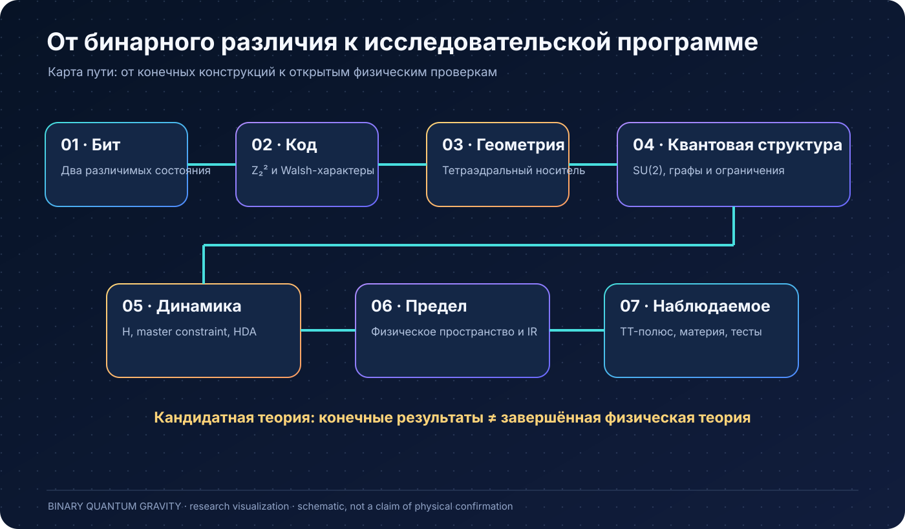

**Визуальный атлас:** [все 50 научных иллюстраций](docs/FIGURE_ATLAS.md) — от базовой геометрии до спиновых сетей, спектральных методов, квантовой пены и зеркальных секторов.

**Честный статус науки:** в проекте зарегистрированы **23 математических утверждения со статусом `proved`** (каждое в своей области и при своих предпосылках), **21 конечномерная проверка** и другие условные результаты. Но **все 9 обязательных условий полной физической теории пока открыты**. Новых завершённых настоящих лоренцевых V4-путей в последнем зафиксированном проходе V26 — **0 из 32 для первой пары**. Не путай программные тесты с доказанной гравитацией.

**Новый технический аудит (11 ноября 2026):** [физический причинный конус полной BQG](BQG_PHYSICAL_CAUSAL_CONE_AUDIT_20261111.md) формализует отдельные gates для вывода часов, rigging map, физического retarded response, универсальности IR-конуса, независимого селектора q и глобальной топологии. Это спецификация следующих проверок, а не заявление об их реализации или прохождении.

**W5 Lorentzian continuation (11 ноября 2026):** [ledger Hermitian ordering и коэффициентов](BQG_W5_HERMITIAN_ORDERING_COEFFICIENT_LEDGER.md) фиксирует точный знак \\( -\\hbar^{-2} \\) для двух anti-Hermitian commutator legs, минимальную symmetric completion и отделяет известный классический множитель \\(1+\\beta^2\\) от ещё не выведенной абсолютной регуляризационной нормировки. На исследовательскую ветку добавлены full-node V10 closure jobs для \\(J_{\\max,2}=10,12,14\\) и отдельный adapter-test workflow; на момент фиксации оба workflow были queued, а не пройдены.
**Интеграция существующих W5-модулей (11 ноября 2026):** [аудит V09/V10/common-carrier](BQG_W5_EXISTING_MODULE_INTEGRATION_AUDIT_20261111.md) связывает уже имеющиеся генераторы и фиксирует точный порядок получения единого (A,B)-носителя, условия сравнения cutoff и блокеры физической нормировки. Отдельно исправлен joint-Gram gate: обязательные явные коэффициенты, идентификаторы базиса и корректный подсчёт структурного правого ядра.
**V11 common carrier (11 ноября 2026):** [сборщик общего W5-носителя](scripts/bqg_v11_w5_common_carrier.py), [регрессионные тесты](tests/test_bqg_v11_w5_common_carrier.py), [pilot workflow](.github/workflows/bqg-v11-w5-common-carrier-pilot.yml). Включает независимую проверку V09 node-sum против V10 forward, контроль (B=B_{sym}+B_{anti}), единый Gauss-носитель и SHA-256 ledger. Исправлен executor-контракт V09/LSINE; см. интеграционный аудит.


**Production-linearity and closure-loss audit (11 ноября 2026):** [новый технический аудит](BQG_PRODUCTION_LINEARITY_AND_CLOSURE_AUDIT_20261111.md) отделяет фиксированное разреживание матричных коэффициентов от state-dependent amplitude pruning. Зафиксирован риск нелинейности production KKV при пороговом накоплении масштабированных вкладов; V10 adjoint residual поэтому трактуется как matrix-level check, а не как доказательство линейности полного production map. Документ задаёт L1/L2/L3 additivity/homogeneity gates, обязательные below-threshold loss diagnostics и cutoff-convergence protocol. Это аудит и план проверок, не заявление о прохождении новых тестов.
**L2 production-primitive audit (11 ноября 2026):** [расширенный source audit](BQG_L2_PRODUCTION_PRIMITIVE_LINEARITY_AUDIT_20261111.md) фиксирует дополнительные state-level threshold boundaries в KKV: произвольные input coefficients, ветвевые суммы, volume action и commutator assembly. Определены map-by-map L2 additivity/homogeneity tests, L3 matrix-reconstruction contract и раздельный loss ledger. Это подтверждённый аудит исходного кода и план gate, не отчёт о прохождении тестов.

---

## Оглавление приключения

**Часть I. С чего всё начинается:** бит → четыре маленьких ответа → тетраэдр → стена → наблюдатель → размерность → время.

**Часть II. Когда геометрия знакомится с квантами:** кубит → SU(2) → склейка тетраэдров → пространство графов → метрика → гравитация.

**Часть III. Где сказка становится серьёзной наукой:** ограничения → физические состояния → HDA → настоящие вычисления W5/W17/W43 → заряд → лоренцева часть → depth-6.

**Часть IV. Что мы ищем дальше:** гладкий предел → гравитон → волны → инфотон и зеркальные миры как гипотезы → научная ценность → честный финал.

**Приложения для старших исследователей:** карта результатов, полный реестр из 55 утверждений, девять физических условий, воспроизводимость, источники и лицензия.

---

# Часть I. Путешествие начинается с самого маленького выбора

## Глава 1. Жил-был бит по имени «Да или Нет»

Представь крохотного сторожа у ворот замка. У него всего две карточки: **0** и **1**. Одна означает «нет», другая — «да». Сторож не знает, что такое вверх, вниз, левее или правее. У него нет даже линейки. Он умеет только различать две возможности.

Такой выбор в вычислениях называют **битом**.

Но важное предупреждение: **один бит сам по себе не содержит длину, массу, силу или пространство**. Чтобы из битов получилось что-то похожее на геометрию, нужно задать связи, правила превращений и способы измерения.

БКГ начинает не с утверждения «Вселенная точно состоит из нулей и единиц», а с исследовательского вопроса: *что удастся построить, если в качестве самого простого алфавита выбрать бинарные состояния?*

**Научная дверца:** классический бит — не то же самое, что квантовый бит. Квантовая суперпозиция появится позже, когда мы научим нашего сторожа работать с комплексными амплитудами.

## Глава 2. Четыре комнатки из двух битов

Один бит различает два состояния. Два бита — уже четыре:

```text
  00     01
  10     11
```

Представь четыре маленьких домика. Пока они не стоят «на севере» или «на юге»: это просто четыре разных имени. Но теперь мы можем задавать каждому дому три простых вопроса. Различать первый бит? Второй? Или совпадает ли их чётность?

Эти вопросы превращаются в три знака: плюс или минус. В математике их удобно назвать **характерами группы** $\mathbb{Z}_2^2$.

Каждому домику сопоставим стрелочку из трёх чисел:

$$
n_{ab}=\frac{1}{\sqrt{3}}
\left((-1)^a,\,(-1)^b,\,(-1)^{a+b}\right),
\qquad a,b\in\{0,1\}.
$$

Пока это кажется хитростью. Но именно сейчас случится наш первый настоящий геометрический фокус.

## Глава 3. Тайна четырёх стрелочек: появился тетраэдр

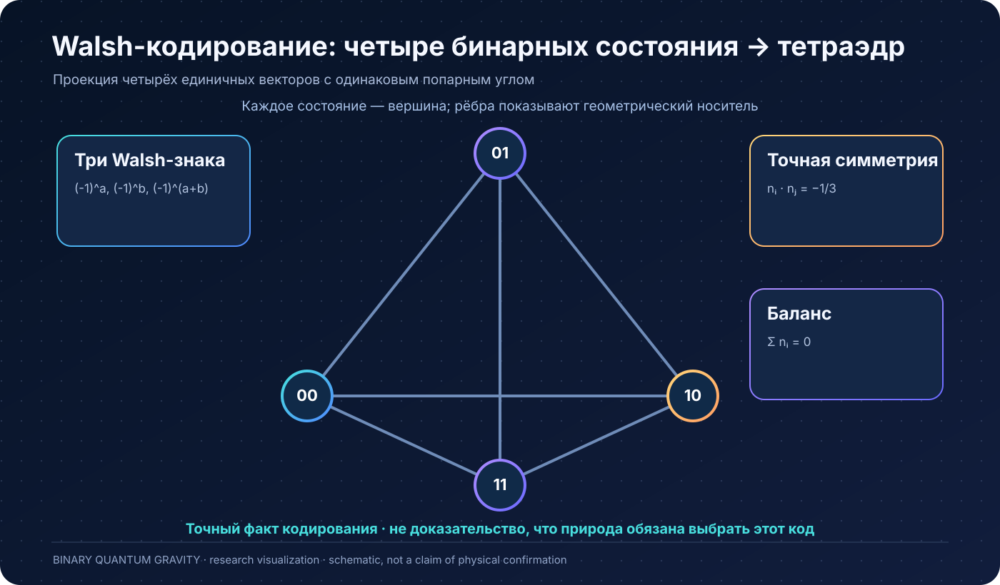


Возьми четыре стрелочки из предыдущей главы и направь их из одной точки. Оказывается, они смотрят в четыре стороны так симметрично, как могут смотреть вершины **правильного тетраэдра** — маленькой треугольной пирамидки.

Всякий раз, когда мы выбираем две разные стрелочки, их скалярное произведение одинаково:

$$
n_{ab}\cdot n_{cd}=-\frac13
\qquad\text{при }(a,b)\ne(c,d).
$$

Все четыре имеют длину 1, а их сумма равна нулю:

$$
\sum_{a,b\in\{0,1\}}n_{ab}=0.
$$

Это и есть математическая магия: у нас были четыре имени из нулей и единиц, а появилась **точная регулярная тетраэдральная симметрия**. Более того,

$$
\sum_{a,b\in\{0,1\}}n_{ab}n_{ab}^{\mathsf T}=\frac43 I_3.
$$

О чём говорят формулы? Стрелочки уравновешивают друг друга, а их направления одинаково распределены по трём осям. В БКГ это называется **Walsh-тетраэдральным носителем**.

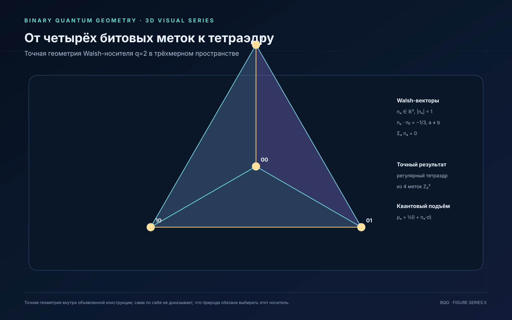

*Четыре бинарные метки задают четыре симметричных направления правильного тетраэдра.*

**Что здесь доказано:** тетраэдр действительно получается из выбранного двоичного кодирования, без подгонки углов вручную. **Что не доказано:** будто сама природа обязана выбирать именно этот код и строить из него пространство.

[Исходное математическое доказательство Walsh-тетраэдра](MICRO_WALSH_QGEOM_BRIDGE.md).

### Промежуточный мост: от одного тетраэдра к геометрической ткани

Но здесь важно не перепрыгнуть через несколько ступеней. **Один тетраэдр — ещё не пространство.** Это одна элементарная геометрическая фигура: у неё есть вершины, рёбра, грани, объём и ориентация. Чтобы получить протяжённую геометрию, нужно научиться соединять множество таких элементов.

Представь, что мы берём второй тетраэдр и прикладываем его к первому общей треугольной гранью. Затем добавляем третий, четвёртый и так далее. При склейке соседние клетки должны согласовать общую грань: ориентации с двух сторон противоположны, а геометрические данные на общей границе не должны противоречить друг другу. Так из отдельных фигур возникает **триангулированный комплекс** — сеть взаимосвязанных объёмных ячеек.

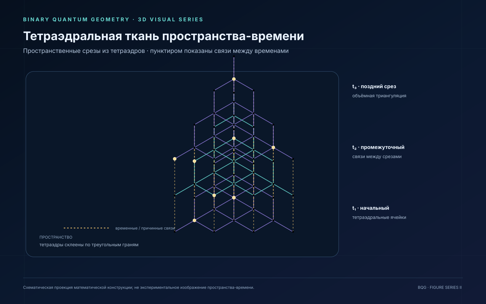

*Схематическая модель показывает не готовую Вселенную, а способ организовать локальные геометрические элементы и связи между ними.*

Теперь у нас есть не просто четыре направления, а структура: какие ячейки соседствуют, какие грани они разделяют, как проходят пути по сети. На таком комплексе можно задавать длины рёбер, площади граней, объёмы ячеек и исследовать, согласуются ли локальные данные в общей геометрии. **Именно здесь появляется возможность говорить о расстоянии и форме между разными участками сети.**

В проекте исследуется конкретная конечная конструкция из 16 тетраэдральных клеток и 32 общих треугольных граней. Позже мы отдельно разберём её склейку и ограничения. Но даже корректно собранная конечная сеть ещё не является непрерывным пространством-временем: для этого нужны контролируемое увеличение числа ячеек, определение физических масштабов и доказательство предела.

### Два разных шага: от геометрической сети к тому, что видит наблюдатель

У этой истории есть две операции, которые легко спутать.

- **Наблюдательное разрешение:** сеть остаётся прежней, но прибор или наблюдатель перестаёт различать маленькие детали. Это похоже на стену, на которую мы смотрим издалека.
- **Укрупнение описания (coarse-graining):** мы математически объединяем множество микроскопических элементов в эффективные блоки и выводим правила для этих блоков. Здесь меняется не сама микроскопическая сеть, а уровень описания модели.

Первый шаг объясняет, почему дискретная структура могла бы быть незаметна глазу. Второй — как из множества микроскопических степеней свободы вообще может возникнуть эффективная крупномасштабная геометрия. **Чтобы получить физическую гладкость, нам нужен второй шаг и доказательство его предела; одного удаления наблюдателя недостаточно.**


## Глава 4. Стена из кирпичиков и путешествие наблюдателя

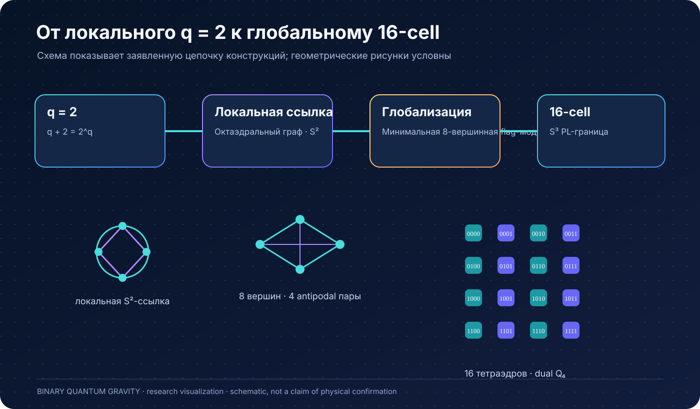


Теперь представь, что мы вышли из замка и стоим возле большой каменной стены. Ты видишь щели между кирпичиками, шероховатость и разные цвета. Поднеси лупу — обнаружатся ещё более мелкие царапины.

А теперь отойди на несколько шагов. Мелкие детали исчезают. Издали стена кажется почти гладкой. Если отойти ещё дальше, даже отдельные кирпичи станут неразличимы.

**Вот центральная аналогия БКГ:** пространство может быть устроено из мелких элементов, хотя на масштабах нашего опыта кажется гладким.

Но наблюдатель не волшебник. **Стена не меняет свою физическую кладку от того, что ты от неё отошёл.** Изменяется способность твоего глаза различать детали.

Если характерный размер кирпичика равен $a$, а расстояние до стены равно $R$, то его видимый угловой размер при $a\ll R$ примерно равен

$$
\theta\simeq\frac{a}{R}.
$$

Если глаз или камера способны различать детали только больше угла $\theta_{\min}$, то при $a/R<\theta_{\min}$ отдельные кирпичики уже нельзя различить.

**Самое важное различие:** «удалиться от стены» — это про наблюдательное разрешение; «усреднить микроструктуру» — это математическая операция, которую мы введём дальше. Сходство образов помогает думать, но не делает эти два процесса одной физической формулой.

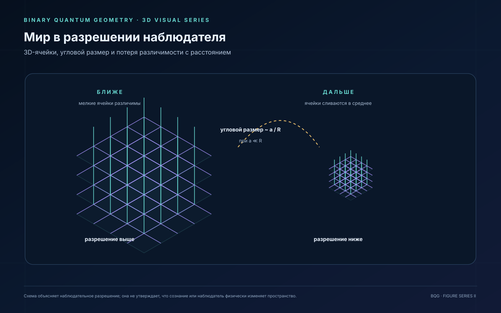

*Схема иллюстрирует, как отдельные элементы становятся неразличимыми при изменении масштаба наблюдения; сама микроструктура от этого не меняется.*

## Глава 5. Как гладкая картинка получается из множества неровностей

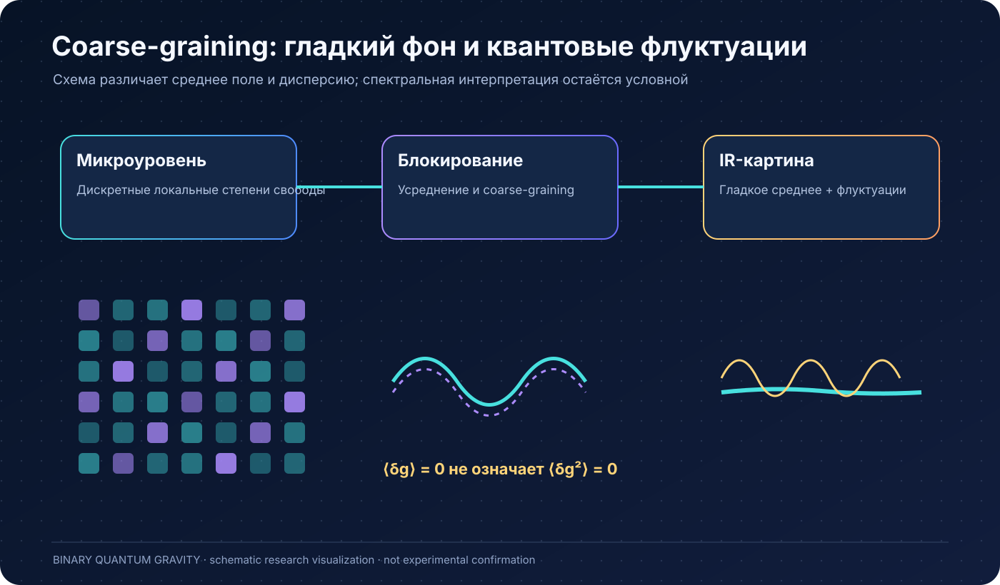


Вблизи у стены своя текстура. Издали цвет каждого крошечного пятна смешивается с соседними. Компьютер делает нечто похожее, когда уменьшает большое изображение: усредняет множество пикселей.

Обозначим размер микроскопического элемента через $a$, а масштаб усреднения через $L$. Для хорошего разделения масштабов нам хотелось бы иметь

$$
a\ll L\ll R_{\mathrm{curv}},
$$

где $R_{\mathrm{curv}}$ — характерный масштаб изменения крупной геометрии (не расстояние до наблюдателя из предыдущей главы).

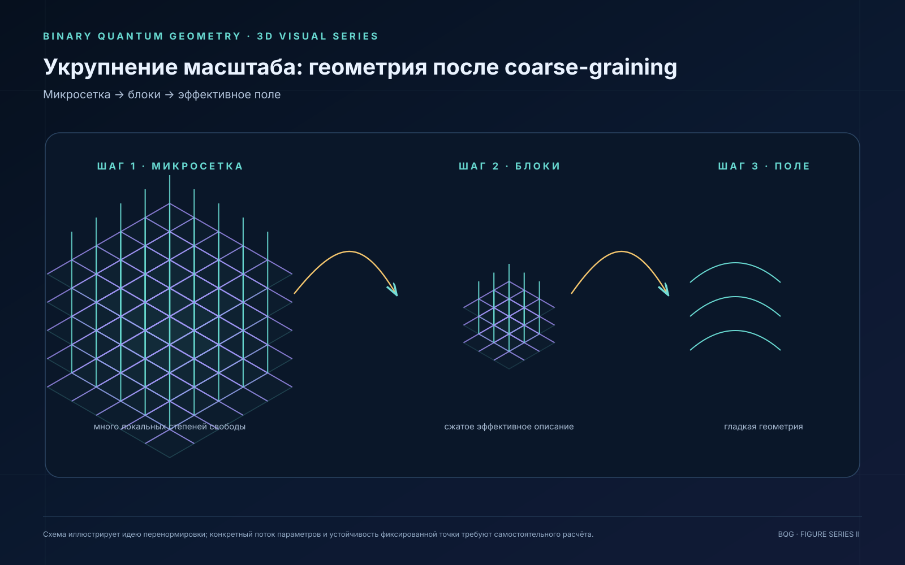

*При coarse-graining множество микроскопических элементов описывается через более крупные эффективные блоки.*

В одной **специально выбранной свободной решёточной модели**, изученной в проекте, частоты волн подчиняются синусному закону:

$$
\omega_a^2(\mathbf{k})
=\frac{4c^2}{a^2}\sum_{i=1}^{3}
\sin^2\left(\frac{k_i a}{2}\right).
$$

Для длинных волн $|\mathbf{k}|a\ll1$ синус почти равен своему аргументу, и получается знакомая почти непрерывная волновая картина.

При гауссовом усреднении для **той же выбранной модели** найдена ведущая поправка:

$$
V_a(L)=\frac{\hbar}{8\pi^2 c L^2}
\left[1+\frac{a^2}{40L^2}
+O\left(\frac{a^4}{L^4}\right)\right].
$$

Здесь $V_a$ — модельная дисперсия сглаженного поля, а не измеренные флуктуации настоящего вакуума БКГ. При $L=100a$ ведущая относительная поправка равна $2.5\times10^{-6}$.

**Что даёт научный результат:** можно точно исследовать, при каких условиях микроскопическая дискретность становится малозаметной. **Чего он не даёт:** доказательства, что реальный вакуум состоит из таких кирпичиков.

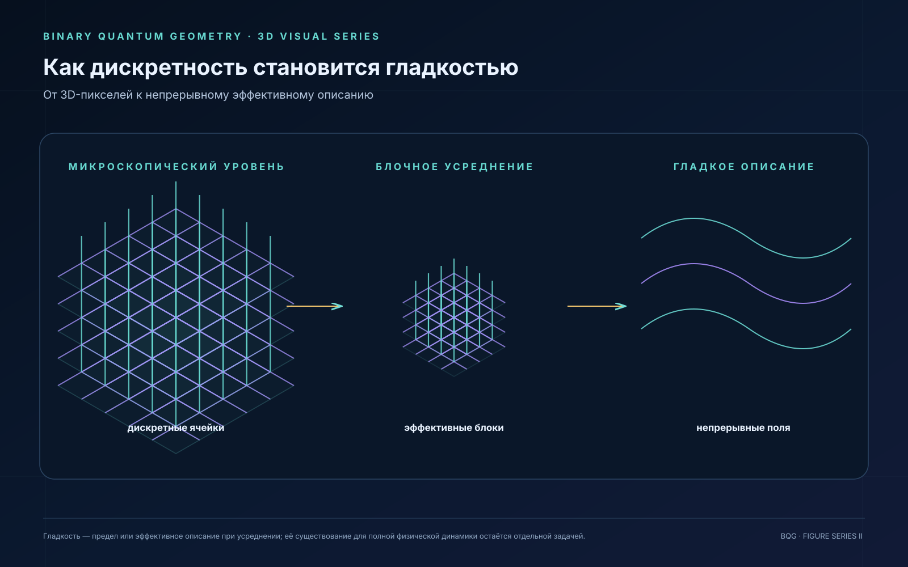

*Это иллюстрация идеи эффективного предела, а не доказательство существования такого предела для полной динамики BQG.*

### Какой предел мы на самом деле хотим получить: гладкое пространство-время и общую теорию относительности

Гладкая картинка — только начало. **Главная цель БКГ не просто сделать дискретную сеть похожей на непрерывную среду. Нужно показать, что из её собственных микроскопических правил возникает физика, которую мы наблюдаем на больших масштабах, — прежде всего общая теория относительности.**

Это означает, что при переходе к крупным масштабам и контролируемом пределе микроскопического масштаба $a$ эффективное описание должно приобрести четыре взаимосвязанных свойства.

1. **Континуальная геометрия.** Должны возникнуть четырёхмерное пространство-время, эффективная метрика $g_{\mu\nu}$ с лоренцевой сигнатурой и устойчивые геометрические наблюдаемые. Недостаточно нарисовать гладкую поверхность: нужно доказать сходимость подходящих корреляторов и геометрических величин при уточнении сети.

2. **Динамика Эйнштейна.** Эффективные уравнения на больших масштабах должны сводиться к уравнениям общей теории относительности, например к форме
   $$
   R_{\mu\nu}-\frac12 Rg_{\mu\nu}+\Lambda g_{\mu\nu}
   =\frac{8\pi G}{c^4}T_{\mu\nu},
   $$
   где $G$ и $\Lambda$ должны быть получены или откалиброваны в рамках одной согласованной модели. Возможные поправки к ОТО должны быть вычислены, контролируемы и не противоречить наблюдениям.

3. **Правильные физические степени свободы и симметрии.** Нужно получить замкнутую алгебру ограничений, включая требуемый континуальный аналог HDA, физический сектор с положительной нормой, причинное распространение и две поляризации свободного гравитационного TT-сектора. Материя должна взаимодействовать с возникающей геометрией согласованным образом.

4. **Независимая проверяемость.** Теория должна давать количественные предсказания — в том числе возможные малые отклонения от ОТО — и выдерживать сравнение с экспериментами и наблюдениями. Предел нельзя объявить успешным только потому, что параметры были подобраны под желаемый ответ.

В предельно короткой форме наша цель такова:

$$
\text{бинарные микроправила}
\;\longrightarrow\;
\text{квантовая геометрия}
\;\longrightarrow\;
\text{континуальный лоренцев предел}
\;\longrightarrow\;
\text{ОТО + контролируемые поправки}
$$

### Две начальные опоры на пути к пределу: причинный конус и спектральный зазор

**Следующий конечный тест полного лоренцева сектора на W5:** [совместный Gram-тест и точные требования к исходным амплитудам](BQG_LORENTZIAN_W5_JOINT_GRAM_GATE.md). Вычислительный gate: [скрипт](scripts/bqg_lorentzian_w5_joint_gram_gate.py).

**Аудит первичного Lorentzian pipeline:** [несовпадение all-j=1/2 и W5 j=2, адаптер сырых K-K-V амплитуд и ограничения Hermitian completion](BQG_W5_LORENTZIAN_PIPELINE_AUDIT.md). Код: [W5 raw-column runner](scripts/bqg_v09_w5_lorentzian_raw_column.py), [структурный Gram aggregator](scripts/bqg_v09_w5_lorentzian_gram_aggregate.py).
**Adjoint audit K-K-V:** [точное сопряжение и запрет циклического переноса частичного auxiliary trace](BQG_LORENTZIAN_EPSILON_KKV_ADJOINT_AUDIT.md); [unit-тест](tests/test_bqg_v09_w5_lorentzian_adjoint.py).
**Классическая нормировка Lorentzian kinetic sector:** [384 численных проверок β-cancellation](verification_results/BQG_CLASSICAL_BETA_CANCELLATION_SEED260809.json): подтверждены $H_E^{kin}=-\beta^2H_{DW}$ и $H_L^{corr}=(1+\beta^2)H_{DW}$ в однородном кинетическом секторе. Это фиксирует классическую целевую комбинацию, но не квантовый коэффициент KKV, не регуляризацию и не физическое упорядочение.
**Точный знак и ħ для двух K-коммутаторов:** [вывод $K_H=[V,H_E]/(i\hbar)$ и множитель $-\hbar^{-2}$ в KKV](BQG_W5_K_COMMUTATOR_NORMALIZATION.md). Это исправляет важную границу между структурным v10-оператором и физически нормированными K-ногами.
**W5 adjoint-closed basis runner:** [строит W5-достижимый базис под когерентной суммой пяти узлов KKV и её независимо вычисленным сопряжением](scripts/bqg_v10_w5_lorentzian_adjoint_closure.py); [тесты индексного порядка и сопряжения](tests/test_bqg_v10_w5_lorentzian_adjoint_closure.py). Результат ограничен объявленным cutoff и лимитами closure.
**Описание adjoint-closure gate:** [алгоритм замыкания, критерий полноты и границы интерпретации](BQG_W5_LORENTZIAN_ADJOINT_CLOSURE.md).

У этой программы есть не только образ дискретной сетки, которая становится гладкой. Уже сейчас мы можем выделить два разных математических направления, которые должны войти в будущий вывод континуального пространства-времени.

**Первая опора — причинность и световой конус.** На тетраэдральной сети можно задавать временную ориентацию связей и исследовать, какие события могут влиять друг на друга. Это необходимый язык для будущей лоренцевой геометрии: в континуальном пределе причинные границы должны перейти в световые конусы метрики, а допустимое распространение сигналов — согласоваться с предельной скоростью. В главе 7 показана схема причинной структуры и обсуждается реляционная история сети. Однако рисунок и конечный причинный граф пока не доказывают, что именно полная динамика БКГ порождает физический световой конус. Для этого ещё нужны выведенная лоренцева сигнатура, динамика и контролируемый предел.

**Вторая опора — спектральный зазор.** В главе 19 для конечного носителя K5/W5 построена матрица Грама

$$
G_{EE}=A^\dagger A,
$$

Для сохранённых десятичных элементов получена строгая рациональная нижняя оценка

$$
\lambda_{\min}(G_{EE})>32.41356.
$$

Это уже конкретный спектральный результат: на данном конечном носителе евклидова карта не имеет нулевого направления, а её минимальное собственное значение отделено от нуля. Он позволяет получить необходимую оценку на силу дополнительного вклада, который мог бы компенсировать эту карту. Но это **не** спектральная щель полного физического гамильтониана, не доказательство физического ядра и не автоматически сохраняющийся зазор при уточнении сети.

**Почему эти две опоры важны вместе:** причинная структура отвечает на вопрос, как в пределе должны быть устроены допустимые связи и распространение; спектральный контроль — насколько устойчивы выбранные конечные операторные каналы и как они могут вести себя при уточнении. Для настоящего континуального предела необходимо показать, что оба свойства относятся к одной и той же физической динамике, согласованно переживают refinement и приводят к лоренцевой метрике с правильным низкоэнергетическим сектором. Пока это исследовательские входы в задачу, а не её завершённое решение.


**Отдельный расчёт с точными сертификатами:** [причинный конус и спектральный зазор W5](BQG_CAUSAL_CONE_AND_W5_SPECTRAL_CERTIFICATE.md), включая точную рациональную проверку пяти главных миноров и воспроизводимый скрипт `scripts/bqg_causal_cone_w5_certificate.py`.

**Если эта цепочка будет строго выведена из микроскопической динамики БКГ, без ручного внесения уравнений Эйнштейна на последнем шаге, это станет центральным доказательством её физической состоятельности в низкоэнергетическом режиме.** Но есть важная научная тонкость: один лишь предел ОТО ещё не доказывает уникальность микроскопической модели — разные фундаментальные теории могут иметь одну и ту же низкоэнергетическую границу. Поэтому нужны также квантовая согласованность, независимые предсказания и проверки, отличающие БКГ от альтернатив.

**Где мы находимся сейчас:** такой полный вывод для БКГ пока не завершён. Приведённый выше синусный закон и поправка для свободной решёточной модели — полезный тест механизма сглаживания в специально выбранной модели, но не вывод четырёхмерной лоренцевой ОТО из полной бинарной квантовой гравитации. Это важный ориентир, а не уже пройденный финиш.


[Вывод синусного свободного benchmark](docs/information_infoton_review/sine_correlations/DERIVATION_RU.md).

## Глава 6. Сколько измерений может вырасти из бинарного правила?

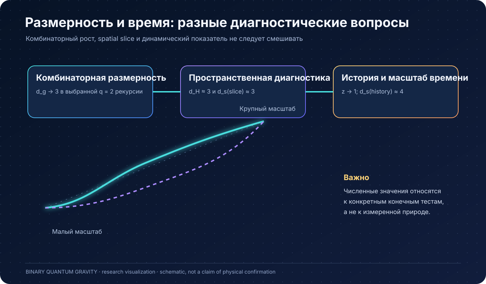


Тетраэдр живёт в трёхмерной геометрии. Но означает ли это, что правило четырёх домиков само доказало трёхмерность всей Вселенной? Нет. Для такого вывода понадобилось бы гораздо больше.

В БКГ имеется другое, совершенно конкретное правило: как поколение за поколением разрастается выбранная сеть бинарных маршрутов. Для этого правила вычислено число элементов:

$$
N_g=\frac{4\cdot8^g+10}{7}.
$$

Если каждое поколение удваивает характерный масштаб, можно определить эффективную размерность через число элементов:

$$
d_g=\log_2\left(\frac{N_g}{N_{g-1}}\right).
$$

Получается удивительный результат:

$$
d_g=3+\log_2\left(1-\frac{35}{16\cdot8^{g-1}+40}\right),
\qquad\lim_{g\to\infty}d_g=3.
$$

Каждый конечный шаг даёт число чуть меньше трёх, а по мере роста сети оно стремится к трём.

**Теорема:** это строго верно для заданной рекурсии. **Открытый вопрос:** выводит ли реальная микродинамика природы такую рекурсию и уникален ли её предел среди разумных альтернатив?

[Точное доказательство размерностного fixed point](Q2_DIMENSION3_FIXED_POINT_CLOSURE.md).

## Глава 7. А откуда взялось время?

Представь волшебную книгу, в которой можно листать страницы. На одной странице тетраэдры соединены так, а на следующей — иначе. Сама стопка страниц ещё не объясняет, почему одна страница должна считаться «раньше», а другая «позже».

Чтобы получить физическое время, мало поставить стрелку на бумаге. Нужны причинные связи, ограничения и часы, которые возникают внутри самой модели или корректно связаны с ней.

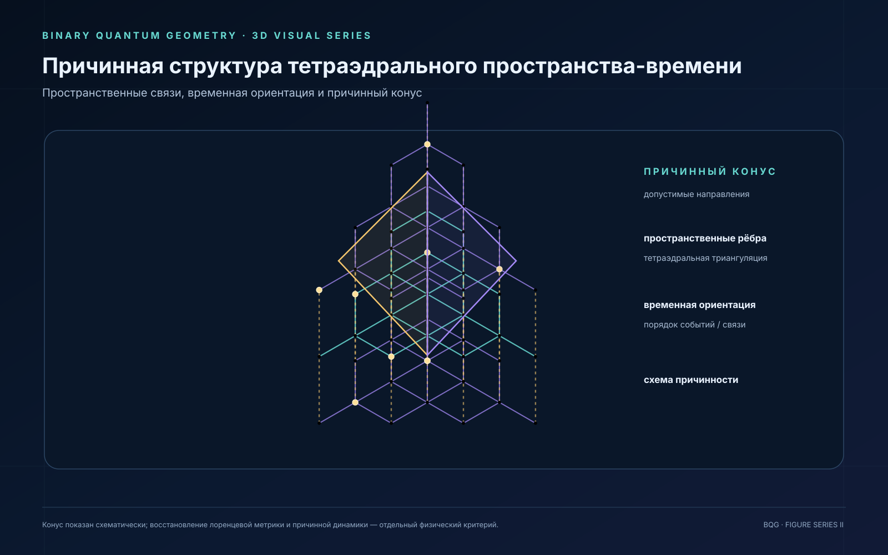

*Схематическая причинная структура помогает различать допустимые связи между событиями; физический световой конус должен быть выведен из динамики.*

В БКГ есть графовые маршруты и конечные модели реляционной истории: один квантовый объект может условно служить часами для другого. Это проверяет математическую возможность такого описания.

Но **настоящее физическое время полной гравитационной модели ещё не выведено**. Не следует путать порядок вычислительных шагов с измеряемым временем Вселенной.

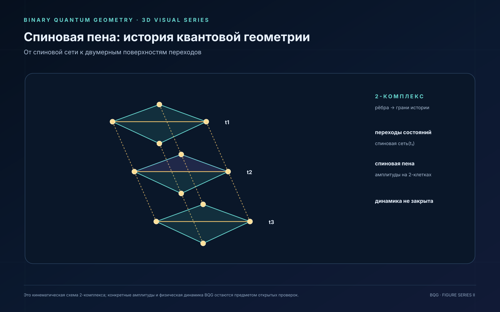

*Спиновая пена изображает не отдельную пространственную сеть, а её возможную историю переходов между конфигурациями.*

---

# Часть II. Наш тетраэдр попадает в квантовую школу

## Глава 8. Бит надевает квантовый плащ

Классический бит — это 0 **или** 1. А квантовый бит, кубит, может описываться суперпозицией:

$$
|\psi\rangle=\alpha|0\rangle+\beta|1\rangle,
\qquad |\alpha|^2+|\beta|^2=1.
$$

Числа $\alpha$ и $\beta$ — комплексные амплитуды. Это не две одновременно прочитанные карточки, а правило для квантовых вероятностей и интерференции.

На сфере Блоха направления наших тетраэдральных стрелок можно превратить в математические состояния кубитов:

$$
\rho_f=\frac12\left(I+\mathbf n_f\cdot\boldsymbol\sigma\right).
$$

$\boldsymbol\sigma$ — три матрицы Паули. Мы не вывели квантовую механику из обычного классического бита; мы **выбрали и строго исследовали квантовое представление** ранее построенных бинарных направлений. Именно это различие защищает нашу сказку от фокусов, выдаваемых за доказательства.

## Глава 9. Четыре кубита, общий узел и строгие правила SU(2)

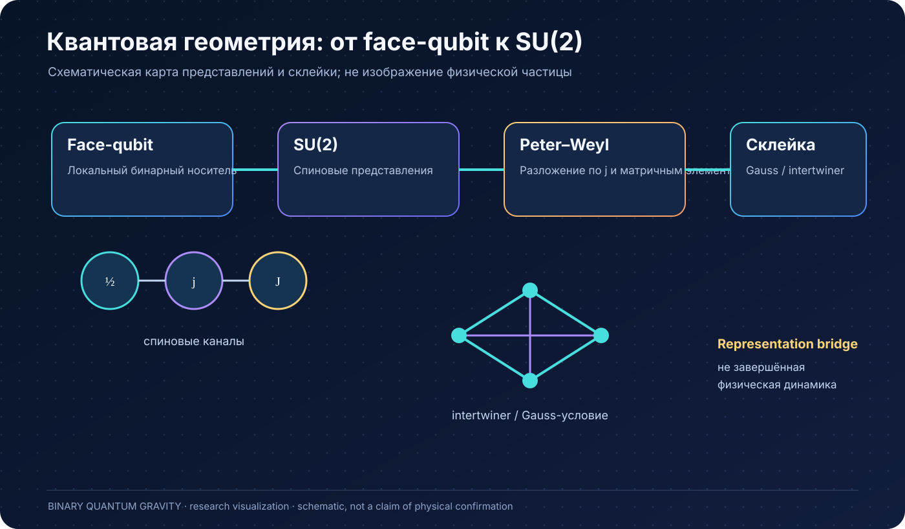


Вообрази четыре ниточки, сходящиеся в узел. Каждая несёт маленький квантовый «спин». У узла есть правило: суммарный поворот не должен менять разрешённое внутреннее состояние. В математике это **Gauss-инвариантность**.

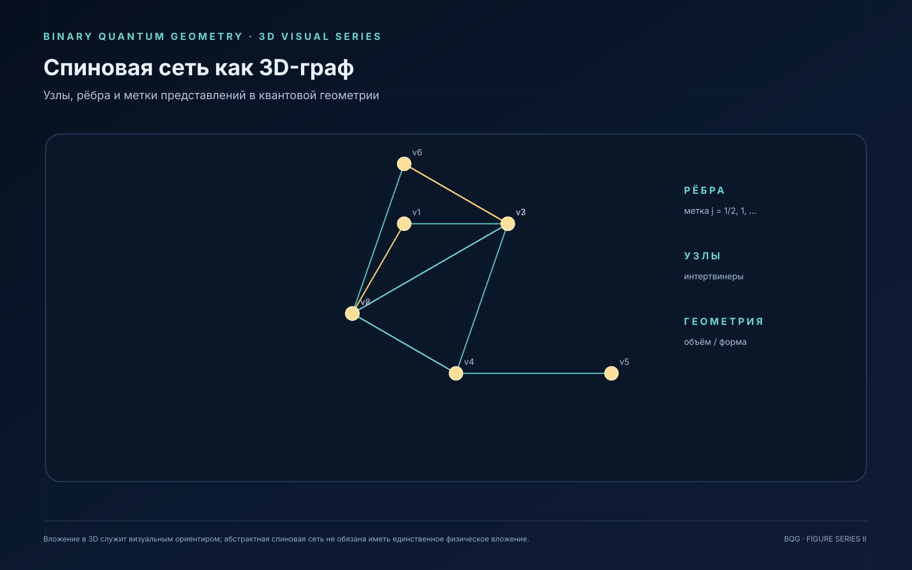

*Узлы и рёбра показывают структуру графа, на котором задаются квантовые степени свободы.*

Для четырёх спинов $\tfrac12$ полное пространство имеет размерность $2^4=16$ и распадается на группы полного спина:

$$
\left(\frac12\right)^{\otimes4}
\cong 2\,V_0\oplus3\,V_1\oplus V_2.
$$

Два состояния общего спина 0 образуют **двумерный синглетный сектор** — удобный логический кубит геометрии.

Здесь подстерегает важная ловушка: в этом же 16-мерном пространстве есть сектор спина 2, но **внутренний SU(2)-спин 2 не является автоматически гравитоном пространства-времени**. Более того, локальные состояния $j=2$ не равны Gauss-синглетам $j=0$.

Наш научный герой становится взрослым, когда учится различать похожие названия и разные физические объекты.

## Глава 10. Почему одной комнаты не хватило: появилась «отсутствующая ниточка»

Четыре бинарных состояния удобно представить как четыре активных состояния квантовой связи. Но под точным действием $SU(2)_L\times SU(2)_R$ они **не образуют** необходимый конечный link bi-doublet.

Инженерный ход БКГ: учесть пятое состояние, уже естественное для изменяющегося графа, — **ниточки нет**. Тогда возникает точное разложение:

$$
\mathbf5=(\mathbf2,\mathbf2)\oplus(\mathbf1,\mathbf1).
$$

Сначала «ниточка отсутствует», затем появляется, затем через неё можно перенести информацию. Два графоизменяющих шага способны воспроизвести выбранную бинарную соседнюю связь.

**Что доказано:** точное представление и алгебраический мост для выбранного носителя. **Что не доказано:** что квантовый вакуум природы действительно устроен именно так.

[Представления graph-link / Peter–Weyl](Q2_GRAPHLINK_PETER_WEYL_BRIDGE.md).

## Глава 11. Из многих тетраэдров складывается замкнутый мир

Положи два тетраэдра общей треугольной гранью. Их стрелочки на этой грани должны согласоваться: что для одного направлено наружу, для другого направлено внутрь.

Продолжай склеивать. В выбранном проектом конечном примере появляются **16 тетраэдральных клеток и 32 общие треугольные грани**. Их соседство описывает граф Q4.


*Срезы и связи на схеме показывают, как можно представлять геометрическую структуру и её связи между слоями.*

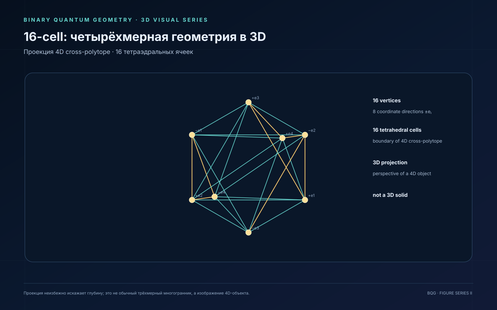

*Это проекция четырёхмерного кросс-политопа; она не означает наличие четвёртого физического пространственного измерения.*

Представь кожуру четырёхмерного кросс-политопа: сами клетки образуют трёхмерную границу. Слова «четырёхмерный политоп» **не означают**, что этим доказано дополнительное физическое пространственное измерение нашей Вселенной.

Конечная согласованная склейка — замечательный шаг от отдельных кубитов к общей геометрии. Но чтобы появились физические гравитационные процессы, тетраэдры ещё должны научиться изменяться по правильным законам.

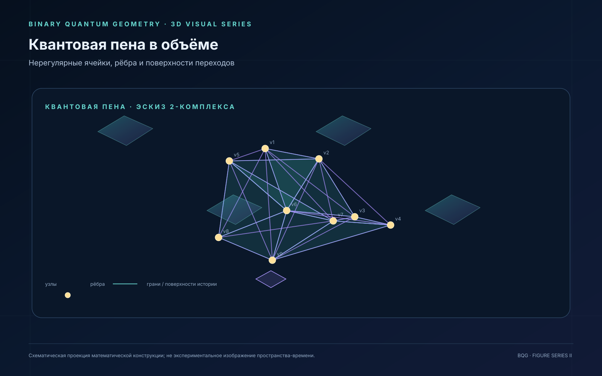

*Квантовая пена здесь — наглядная гипотеза о сложной микрогеометрии, а не установленная физическая структура пространства-времени.*

## Глава 12. Как из стрелочек получить линейку и кривизну

Линейка нужна для расстояний, а кривизна — чтобы отличать плоскость от поверхности шара. В геометрических формализмах гравитации есть путь от двухформ $B$ к метрическому тензору $g_{\mu\nu}$ и соединению.

В БКГ построены **конечные контрольные примеры**, где заданная информация face-qubit проходит через условия простоты (simplicity), реконструкцию Урбантке и проверку эйнштейновой геометрии:

```text
face-qubits → B-поле → simplicity → метрика → соединение → кривизна
```

Положительный пример восстанавливает объявленную геометрию, а отрицательный проверяет, что неправильные данные не принимаются молча.

**Самое честное уточнение:** это не доказательство самостоятельного возникновения закона Эйнштейна из всей микродинамики. Мы научились проверять мост на построенных образцах; ещё нужно вывести, почему природа сама пойдёт по нему.

[Проверка face-qubits → Einstein](QUBIT_TO_EINSTEIN_END_TO_END.md).

## Глава 13. Что такое гравитация в знакомом нам мире

Представь большой батут, на который положили тяжёлый шар. Маленькие шарики меняют пути — такая картинка помогает увидеть идею искривлённой геометрии. Но настоящий мир не обязан быть натянутой тканью, и причина гравитации в общей теории относительности описана точнее.

Уравнение Эйнштейна связывает геометрию с энергией и импульсом:

$$
R_{\mu\nu}-\frac12g_{\mu\nu}R
+\Lambda g_{\mu\nu}
=\frac{8\pi G}{c^4}T_{\mu\nu}.
$$

Для нашей сказки главное: **ОТО уже прекрасно описывает множество наблюдений**. БКГ должна не отменить это знание, а объяснить, как правильное уравнение могло бы появиться из более мелкой квантовой структуры.

---

# Часть III. Стражи, которые проверяют каждое правило

## Глава 14. Три стража физического замка

Наши тетраэдры хотят стать настоящей физической Вселенной. Но у ворот стоят три стража.

**Страж Gauss** спрашивает: «Совместимы ли ваши внутренние повороты?»

**Страж движения** спрашивает: «Правильно ли вы обращаетесь с изменениями координат и пространственными переносами?»

**Страж Hamiltonian** спрашивает: «Удовлетворяет ли ваше состояние квантовой динамике, а не только красивой геометрии?»

Физическое состояние обязано пройти все согласованные ограничения. Существование отдельного оператора или красивого нулевого числа ещё не означает, что стражи открыли двери.

## Глава 15. Как из многих замков сделать один: master constraint

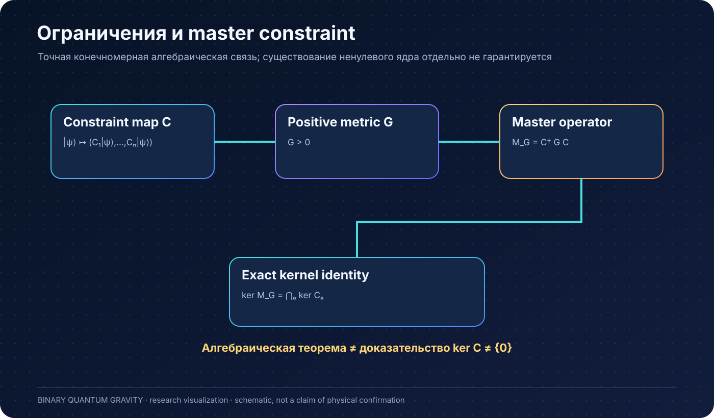


Представим набор ограничений $C_A$. Можно объединить их в один неотрицательный оператор с положительно определённой метрикой $G$:

$$
M_G=C^\dagger G C\ge0.
$$

Есть точная конечномерная теорема:

$$
\boxed{\ker M_G=\bigcap_A\ker C_A.}
$$

Это означает: нуль master-оператора — именно совместное решение всех включённых ограничений. Прекрасный математический инструмент!

Но если ни одного ненулевого вектора, проходящего все замки, нет, master constraint не создаст его из воздуха. **Ненулевое физическое ядро полного гамильтониана БКГ пока не установлено.**

[Теорема о конечном master constraint](MASTER_CONSTRAINT_PHYSICAL_PROJECTOR.md).

## Глава 16. Главная проверка согласованности: два шага туда и обратно

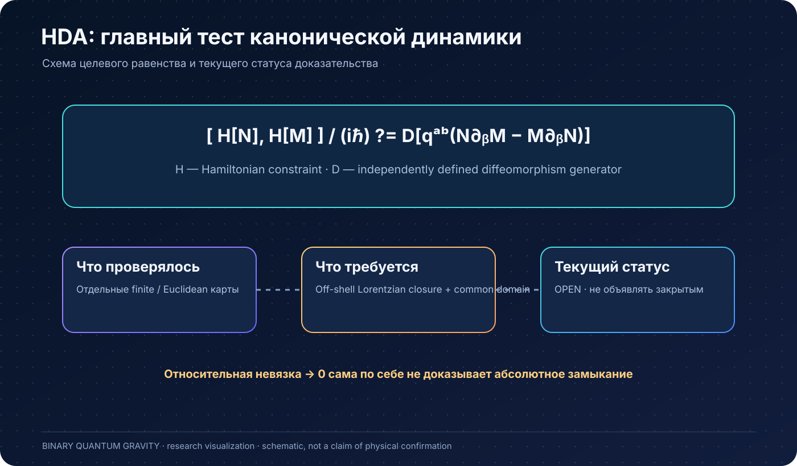


Допустим, мы сначала изменяем геометрию способом $H[N]$, а затем способом $H[M]$. Если поменять порядок, результат может отличаться. В общей теории относительности это различие подчиняется строгому правилу — **алгебре деформаций гиперповерхностей**, сокращённо HDA.

В символах цель выглядит так:

$$
[H[N],H[M]]
\stackrel{?}{=}i\hbar\,D\!\left[
q^{ab}\left(N\partial_bM-M\partial_bN\right)
\right].
$$

Знак вопроса принципиален: это **условие, которое ещё нужно доказать** для нашего полного квантового оператора, а не итог БКГ.

Действие $D$ необходимо определить независимо. Подстроить его после измерения коммутатора нельзя: тогда проверка превратится в круговое объяснение.

## Глава 17. Почему евклидов путь ещё не лоренцев путь

В математике удобно начинать с евклидовой версии, где некоторые вычисления проще. Но физическая геометрия пространства-времени имеет лоренцеву структуру. В БКГ рассматриваются евклидовы действия $H_E$, лоренцевы $H_L$ и маршрутные вклады $R$.

Даже если удалось вычислить отдельные матричные элементы $H_E$, полное уравнение ещё не готово:

$$
H_{\mathrm{full}}=H_E+H_L+R
$$

— это схема обозначения полного семейства при выбранных коэффициентах и нормировках; их нужно зафиксировать для конкретного расчёта. До завершения всех необходимых комплексных каналов нельзя считать $H_L$ измеренным.

**Главная незавершённая вычислительная работа:** получить настоящие 32 финальных V4-пути для первой физической лоренцевой пары, затем проверить их четырьмя независимо вычисленными V2-примитивами и продолжить к остальным парам.

## Глава 18. Почему компьютер иногда находит «нуль», которого нет

Представь школьника, который сложил два огромных числа почти противоположного знака. Разница крошечная, а калькулятор округлил всё до нуля. Если от этого зависит доказательство, начинается беда.

В БКГ были найдены случаи, когда очень маленькие комплексные амплитуды исчезали при преждевременном отсечении. В ещё одном тесте сравнение $10^{-200}$ с нулём ошибочно проходило как «совпадение» из-за численного underflow.

В версиях V22–V26 разработаны и проверены программные защитные методы: сохранение полных комплексных состояний, контроль SHA256, прямое суммирование с повышенной точностью и точная рациональная перепроверка маленьких задач.

**Но:** более точное сложение **уже округлённых** SU(2)-амплитуд не возвращает информацию, потерянную в исходной операции. Для строгого научного результата нужны погрешности на всём пути вычисления.

## Глава 19. Пять зеркал W5: настоящее измерение спектрального зазора

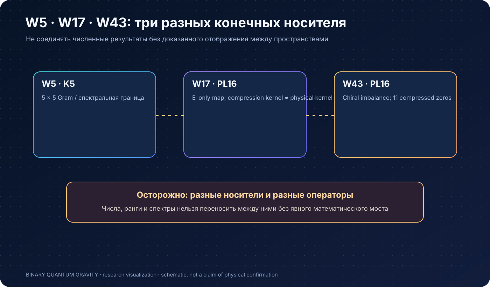


На одном конечном носителе K5/W5 вычислена комплексная матрица Грама $G_{EE}=A^\dagger A$ размером $5\times5$. Её пять собственных значений положительны; первое примерно равно $32.4135645$.

Для сохранённых **десятичных элементов** дополнительно получено точное рациональное ограничение:

$$
\lambda_{\min}(G_{EE})>32.41356.
$$

Если полный оператор на *этом же носителе* имеет вид $H=-\tfrac23 A+Q$, то наличие хотя бы одного нулевого направления требует приблизительно

$$
\|Q\|_{\mathrm{op}}>3.79552719.
$$

Иначе неизвестная часть $Q$ просто слишком слаба, чтобы компенсировать уже вычисленную евклидову карту.

**Границы честности:** это необходимое условие для данного W5, не вычисленная величина настоящего лоренцева $Q$ и не доказательство существования физического ядра.

## Глава 20. Ловушка W17: пятнадцать призрачных нулей

Представь, что мы видим только свет, остающийся внутри комнаты. Если луч вышел через окно, в комнате стало темно. Но означает ли это, что луч исчез? Нет — он снаружи!

Так же работает опасность сжатия оператора. Пусть $P$ — проектор на пространство W17, а $E_0$ — евклидов оператор. У сжатой матрицы $PE_0P$ ранг только 2, поэтому кажется, будто у неё **15 нулевых направлений**.

Но полное измеренное действие $E_0P$ имеет ранг **17**. Эти пятнадцать «нулей» — лучи, покинувшие комнату.

Точное следствие для измеренной карты:

$$
\dim\operatorname{span}\!\left(
W17,\,E_0\ker(PE_0P)\right)=32.
$$

Это одно из важных открытий аудита: **нулевой вектор сжатия не обязан быть физическим нулём полного оператора**.

## Глава 21. W43 и тайна одиннадцати хиральных нулей

Представь музыку, где ноты всегда приходят парами: одна звучит выше нуля, другая — точно настолько же ниже. Хиральный оператор определённой блочной формы ведёт себя похоже:

$$
H_{\mathrm{ch}}=
\begin{pmatrix}
0&B\\
B^\dagger&0
\end{pmatrix}.
$$

Если два блока имеют размеры $n_+$ и $n_-$, то

$$
\dim\ker H_{\mathrm{ch}}
=n_++n_--2\operatorname{rank}B
\ge |n_+-n_-|.
$$

На W43 эти размеры равны 27 и 16. Поэтому **минимум 11 нулей предписаны самой структурой блоков**. Архивные конечные данные показывают именно 11.

Это красивое объяснение математических нулей, но **не одиннадцать обнаруженных гравитонов** и не одиннадцать готовых физических состояний.

## Глава 22. Десять вопросов, на которые HDA ещё должна ответить

На PL16 измерены десять независимых евклидовых коммутаторных выходов. У их матрицы $C$ численный ранг 10 и минимальное сингулярное число около $1.3241893$.

Пусть полный невязочный оператор на этих десяти вопросах равен

$$
\mathcal R=\frac49 C+K,
$$

где $K$ — **все** ещё не вычисленные компенсирующие вклады плюс независимо определённая правая часть HDA. Если $\operatorname{rank}K\le9$, то математически необходимо

$$
\|\mathcal R\|_{\mathrm{op}}
\ge\frac49\sigma_{\min}(C)
\approx0.58852859.
$$

Значит для точного закрытия этих десяти измеренных направлений компенсатор должен быть как минимум десятиранговым в соответствующем смысле. Но **истинный полный $K$ пока не вычислен**.

Здесь нельзя выдавать условное математическое препятствие за доказанную аномалию гравитации.

## Глава 23. Двенадцать дверей зарядовой ковариантности

В другой серии вычислений у БКГ есть двенадцать ориентированных евклидовых каналов, каждый из которых состоит из множества комплексных путей. Когда их вклады почти взаимно уничтожаются, обычный машинный расчёт рискует потерять малый ненулевой остаток.

Особенно трудными оказались ориентации **0, 3 и 6**. Для шестой отношение некогерентного квадрата нормы к сохранённому квадрату когерентной нормы достигает примерно $5.90\times10^{17}$.

Это **не доказательство**, что физическая амплитуда нулевая. Скорее наоборот: знак «проверь высокоточно».

Полное условие зарядовой ковариантности имеет вид

$$
\epsilon_{\mathrm{charge}}=
\frac{\|(I-P_{\mathrm{charge}})H_E^{\mathrm{sine}}\psi\|}
{\|H_E^{\mathrm{sine}}\psi\|}.
$$

Его необходимо измерять после **общего когерентного сложения всех ориентаций**; раздельные скалярные нормы не позволяют восстановить общий комплексный результат. Если знаменатель равен нулю, отношение вообще не определено, и нужен другой критерий абсолютной утечки.

В V26 создан программный высокоточный маршрут, но настоящие исходные ориентации 0/3/6 с ним ещё не пересчитаны.

## Глава 24. Огромный замок глубины шесть

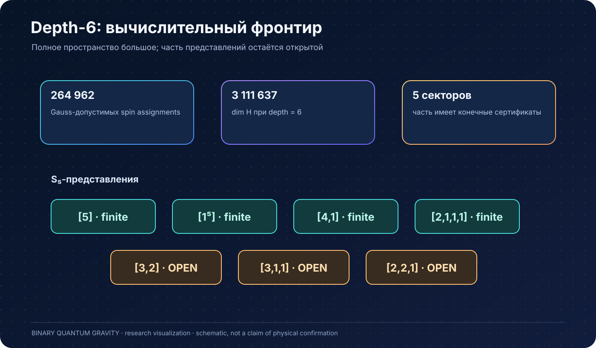


За маленькими носителями скрывается гораздо более крупная задача. В выбранном пространстве глубины шесть имеется **3 111 637** квантовых базисных состояний. Симметрия позволяет разложить задачу на сектора.

Для четырёх секторов существуют конечные численные сертификаты. Три ещё ожидают независимых численных свидетелей:

$$
[3,2],\qquad[3,1,1],\qquad[2,2,1].
$$

Структурная проверка — как план здания: она показывает, где должны стоять балки. Но лишь вычисление ранга настоящего оператора подтверждает, выдерживает ли конструкция математическую нагрузку.

В реестре честно написано: **теорема о полном ядре depth-6 пока не доказана**.

[Текущее состояние depth-6](depth6_frontier.json).

---

# Часть IV. Что скрывается за следующими дверями

## Глава 25. Может ли настоящий гравитон родиться из этой геометрии?

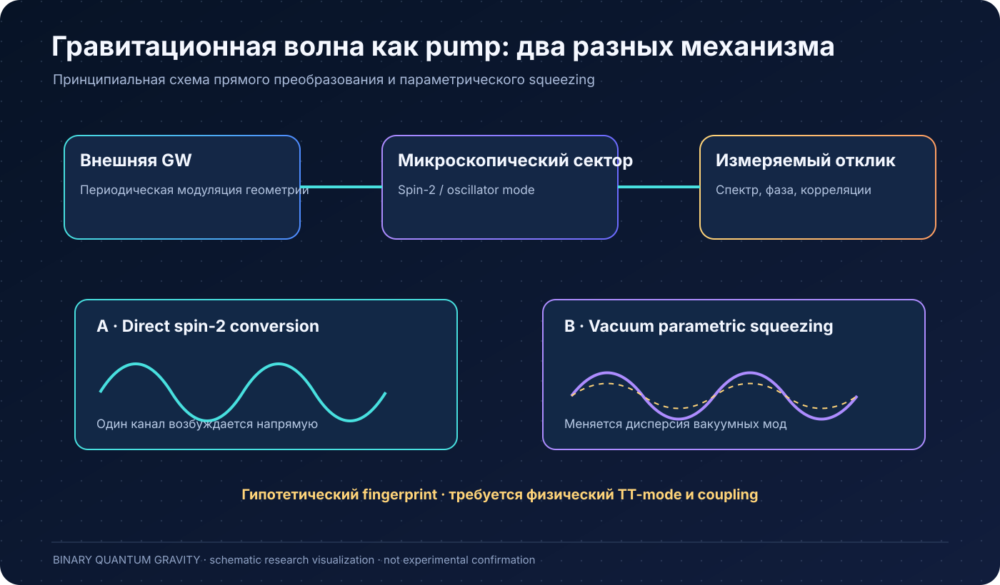


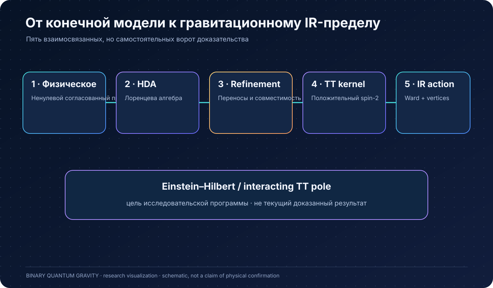


В квантовом описании слабых гравитационных волн говорят о гравитонах. Это связано с **физическими возбуждениями спина 2**, а не с любым математическим сектором, где написано число 2.

Нам нужен физический **TT-отклик** (transverse-traceless — поперечный и бесследовый), положительная норма, правильные две поляризации, причинность и взаимодействия.

Схематически путь выглядит так:

$$
\{C_A\}\longrightarrow M
\longrightarrow P_{\mathrm{phys}}
\longrightarrow Z[J]
\longrightarrow W[J]
\longrightarrow\Gamma[g]
\longrightarrow K_{\mathrm{TT}}(\omega,\mathbf{k}).
$$

В БКГ разработаны конечные положительные TT-контроли и точная алгебраическая классификация **шести независимых quartic TT-структур** для выбранного симметрийного класса. Но **физический взаимодействующий TT-полюс из полного гамильтониана пока не получен**.

## Глава 26. Чем может быть «инфотон»?

В нашей сказке хочется назвать информационную волну «инфотоном» — маленьким посланником между битами и геометрией. Это интересное имя для гипотезы, но пока нельзя показывать на формулу и говорить: «Вот, мы обнаружили частицу».

Нужно определить, что инфотон означает математически: внутренний регистр, коллективную моду или самостоятельное физическое возбуждение. Затем построить корреляторы, проверить нормы, симметрии и возможные взаимодействия с физическим TT-полем.

До этого **инфотон — исследовательское понятие, не экспериментально открытая частица**.

## Глава 27. А зеркальный тетраэдр может отталкивать?

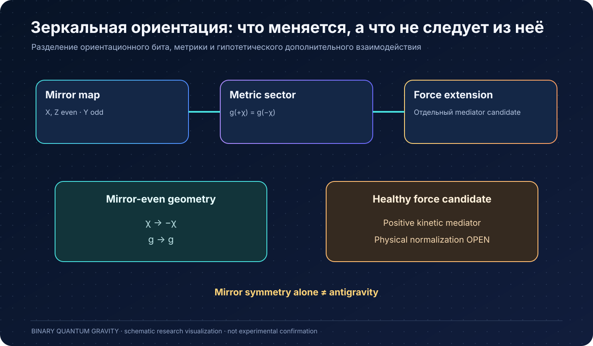


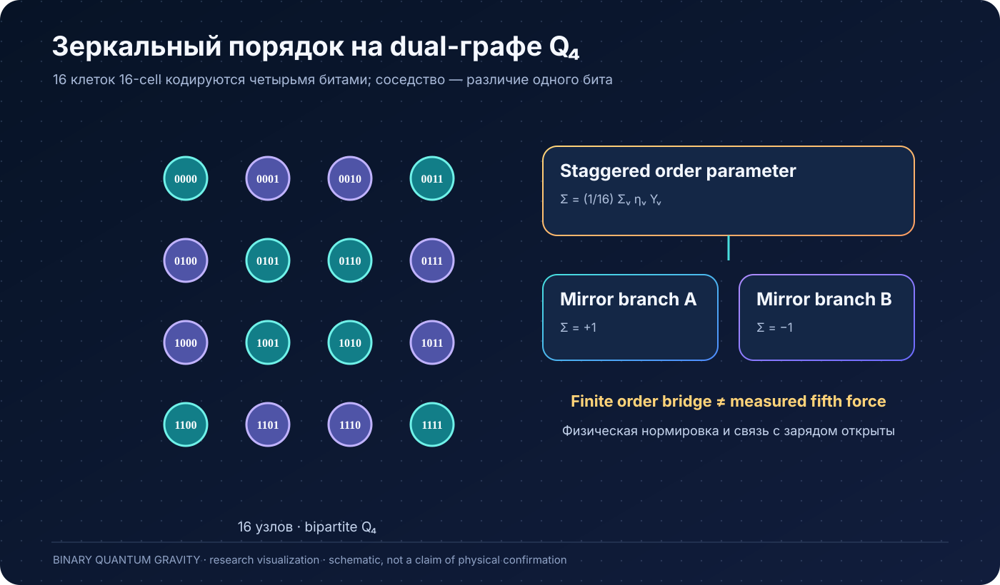


Переверни бумажный тетраэдр в зеркале. Его форма и длины рёбер не изменятся, но ориентация поменяется. В геометрических моделях это можно описать знаком ориентированного объёма.

Здесь исследуются хиральность, условные зеркальные сектора и модели дополнительного взаимодействия. Однако **зеркальная геометрия сама по себе не доказывает антигравитацию**, изменение знака энергии или существование скрытой материи.

Чтобы сказать «существует новая сила», надо вывести здоровый гамильтониан, исключить отрицательно-нормированные моды, выполнить HDA, вычислить реальную связь с источниками и сравнить с наблюдениями.

Тогда из сказочного зеркала может получиться научная проверяемая гипотеза. Пока это отдельная исследовательская ветка.

## Глава 28. Можно ли войти в четвёртое пространственное измерение или второе время?

Кожура четырёхмерного многогранника не равна физическому четвёртому пространственному измерению, а графовая «страница» не равна дополнительной временной координате.

В БКГ обсуждаются две самостоятельные гипотезы: extra spatial dimensions и 2T. Для первой нужны физические координаты, спектр мод и наблюдаемые переходы. Для второй — правильные ограничения, положительный физический сектор и устранение нежелательных степеней свободы.

**Ни переходы в дополнительные измерения, ни вторая физическая временная ось не доказаны.**

## Глава 29. Что уже принесли настоящие научные открытия

Наш путь не был напрасным. Даже если когда-нибудь окажется, что природа не выбирает именно такую бинарную микроструктуру, мы получили полезные математические инструменты.

- **Точный тетраэдр из бинарных меток:** хороший тестовый случай информационной и квантовой геометрии.
- **Теоремы о Gauss-носителях и S₄:** понимание того, когда логический геометрический сектор единственен, а когда требуется выбирать его по спектральному зазору.
- **Новые фильтры физических нулей:** метод отличать истинное ядро оператора от ложного нуля конечномерного сжатия.
- **Строгие необходимые оценки HDA:** возможность отсеивать слишком слабые или недостаточно ранговые компенсаторы до дорогого полного расчёта.
- **Защита от численных ложных нулей:** метод прямого высокоточного сложения сложных комплексных состояний.
- **Шесть TT-структур в выбранном EFT-классе:** подготовка будущей проверки гравитационно-волновых наблюдаемых, если они будут выведены из физического действия.

Нужно строго различать: математическая содержательность проекта — реальна в доказанной области; **приоритет новизны по отношению к научной литературе** требует отдельного независимого обзора и рецензирования.

## Глава 30. Девять дверей, которые пока закрыты

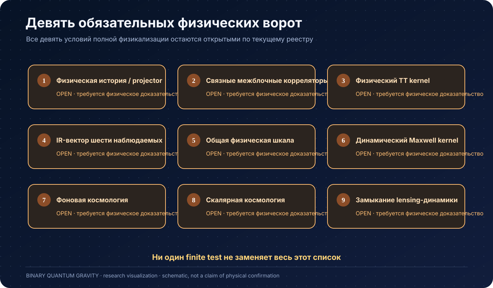


Читатель уже знает многие слова сказки. Теперь представь девять тяжёлых дверей научного замка. Для доказанной физической БКГ их нужно открыть все:

1. Собственный физический проектор или история из реальных гравитационных ограничений.
2. Связанная физическая история между блоками.
3. Выведенное взаимодействующее физическое TT-ядро.
4. Шесть настоящих микроскопических Wilson-коэффициентов.
5. Одна общая физическая нормировка/калибровка масштаба.
6. Динамический фотонный/Maxwell-сектор из той же истории.
7. Физическая однородная космология.
8. Физические скалярные космологические возмущения.
9. Согласованная динамика тел, линзирование и волновая оптика из одного действия.

По состоянию на 9 ноября 2026 года все девять помечены в репозитории как **open_physical**.

[Машинный реестр девяти условий](physicalization_gates.json).

## Глава 31. Как учёные будут проверять конец сказки

Учёный — не тот, кто всегда говорит «получилось». Учёный — тот, кто способен честно сказать «здесь доказано», «здесь только проверено на модели» и «здесь пока неизвестно».

Чтобы получить полный результат, программа требует:

```text
Подлинные SU(2) амплитуды и зарядовая когерентность
                     ↓
32/32 финальных V4-путей и независимая V2-проверка
                     ↓
Полный графоизменяющий Lorentzian H
                     ↓
Ненулевое совместное физическое ядро
                     ↓
Независимая безаномальная off-shell HDA
                     ↓
Контролируемый физический континуальный предел
                     ↓
Положительный взаимодействующий TT-гравитон
                     ↓
Einstein IR и замороженные физические предсказания
                     ↓
Независимая внешняя проверка
```

Ни одна красивая иллюстрация, высокая точность отдельного числа, количество тестов или совпадение заранее выбранного контрольного примера не заменяет этот путь.

## Глава 32. Сказка, у которой пока нет последней страницы

В самом начале у нас были только две карточки: **0** и **1**. Мы придумали им соседей, построили четырёхдомиковый город и открыли в нём тетраэдр. Мы рассмотрели кирпичную стену и поняли, как её неровности исчезают из виду, когда наблюдатель отходит. Мы научили стрелочки становиться квантовыми состояниями, объединили тетраэдры в целую поверхность, поставили стражей у ворот физической динамики и обнаружили, что у компьютера бывают обманчивые нули.

Но последняя страница пока пуста. На ней должен появиться не обещанный, а **выведенный** физический гравитон, правильная общая теория относительности и новые независимые предсказания.

На этой странице нельзя писать «конец», пока доказательство не закончено.

> **Мораль нашей научной сказки:** красивые идеи достойны смелости, а настоящие открытия — проверки. Иногда правильное «ещё не доказано» приближает нас к истине сильнее, чем сто уверенных, но неверных «готово».

---

# Приложение А. Атлас результатов для юных исследователей, которые подросли

В большой библиотеке нашего замка у каждой находки есть карточка. На ней не просто написано «доказано», а указано, **какое именно утверждение доказано и в какой модели**.

## Как читать научные карточки

| Метка | Что она означает |
|---|---|
| `proved` | Есть доказательство математического утверждения при заданных предпосылках. |
| `tested_finite` | Выполнена конечномерная или программная проверка, не доказывающая бесконечный предел. |
| `conditional` | Вывод следует из предпосылок, но они ещё не выведены из всей БКГ. |
| `no_go` | Показано, что конкретный класс решений не работает. |
| `external_extension` | Возможное усиление результатов или проверка универсальности. |
| `experimental_test` | Протокол будущей независимой проверки, а не проведённое наблюдение. |
| `open_physical` | Обязательный физический шаг ещё не завершён. |

Ниже перечислены **все 55 записей основного структурного реестра** по состоянию на редакцию README. Формулировки здесь переведены на понятный русский и сокращены; официальные границы утверждений нужно сверять с [theory_gates.json](theory_gates.json).

## А.1. Двадцать три зарегистрированных математических теоремы

| Код результата | Что именно установлено в заданной модели |
|---|---|
| `DIM3_FIXED_POINT` | Зафиксированная рекурсия q=2 даёт монотонный предел эффективной размерности 3. |
| `MICRO_WALSH_TETRA` | Три Walsh-характера четырёх бинарных меток образуют правильный тетраэдр и заданный квантовый lift. |
| `MICRO_GLOBAL_GLUE` | На выбранной 16-cell PL-конструкции согласованы общие грани, знаки ориентации и потоки. |
| `Q2_GRAPHLINK_REP` | Четыре активных состояния плюс no-link реализуют точный endpoint-носитель и графоизменяющее разложение соседства. |
| `LOGICAL_METRIC_JACOBIAN` | Две логические геометрические вариации дают два ортогональных бесследовых направления метрики с точным рангом 2. |
| `LHDA_COMP` | На заданном фиксированном cutoff и предпосылках доказаны относительные оценки cross/D и geometry/D. |
| `DEWITT` | Для объявленного локального двухпроизводного канонического класса условия HDA выделяют нужную DeWitt-кинетическую структуру. |
| `S4_TT_QUARTIC` | В заявленном parity-even on-shell S₄ TT-классе шесть независимых квартетных структур. |
| `SIX_WILSON_EXTRACTOR` | Шесть выбранных проб дают извлекатель коэффициентов полного ранга с ненулевым точным определителем. |
| `NEAREST_BLOCK_S3` | Симметричный перенос между соседними блоками сводится к двум матрицам 2×2 с шестью вещественными амплитудами. |
| `ON_SHELL_WILSON` | В выбранном on-shell-классе члены, пропорциональные ведущему уравнению TT, устранимы заменой полей. |
| `FESHBACH` | Точные конечномерные тождества Schur/Feshbach и block-Krylov для объявленного эрмитова ограничения. |
| `REAL_GW_MAP` | Алгебраическое соответствие шести TT-коэффициентов выбранным оптическим и дисперсионным наблюдаемым. |
| `REFINEMENT_PROJECTOR_STABILITY` | Устойчивость проектора при refinement ограничивается остатком intertwining и спектральным зазором. |
| `CANONICAL_REFINEMENT_RESIDUAL` | На выбранной S₄-изометрии остаток уточнения ортогонально разделяется на утечку и внутреннее динамическое несогласование. |
| `S4_LOGICAL_MULTIPLICITY` | Кратность S₄-[2,2] в четырёхспиновом синглетном секторе равна $\lceil2j/3\rceil$. |
| `MULTIPLICITY_CHANNEL_SELECTION` | Изолированный спектральный канал выбирает устойчивый S₄-ковариантный логический подноситель. |
| `SCALE_FREE_REFINEMENT_RESIDUAL` | Сформулирована безмасштабная оценка нарушения физического projector refinement после оптимизации нормировки. |
| `SELECTED_CHANNEL_INTERTWINER` | После выбора невырожденных каналов S₄-intertwiner между масштабами единственен с точностью до фазы. |
| `CONSTRAINT_LEVEL_REFINEMENT_BOUND` | Одношаговые остатки ограничений позволяют оценивать более дорогую ошибку master-refinement. |
| `TWO_SIDED_HABITAT_REFINEMENT` | Двусторонние остатки и совместимые носители дают оценку graph-changing master-refinement. |
| `ANCILLA_PETER_WEYL_REFINEMENT` | Для $V_j\to V_{j+1/2}$ необходим ancilla spin-1/2; в симметричном канале есть единственный SU(2)-эквивариантный мост. |
| `MICROSCOPIC_BILINEAR_REFINEMENT` | В объявленной q=2 модели существует единственный билинейный S₄-intertwiner между соответствующими [2,2]-каналами. |

**Почему важно:** каждое утверждение — отдельная математическая «доска» будущего моста. Но 23 доски ещё не означают, что через неизвестную пропасть готов безопасный физический мост.

## А.2. Двадцать одна конечномерная проверка

| Код проверки | Что проверено |
|---|---|
| `BITQ2` | Объявленные бинарные маршруты и их контрольные выборки. |
| `MAN3` | Конечная ориентируемая трёхмерная PL-конструкция, её links и гомологии. |
| `Q2EIN` | Заданный контроль face-qubit → B → метрика → curvature и отрицательный пример. |
| `L1_METRIC_PRECURSOR` | Спектральные E/T2 каналы конечного S₄-сжатия. |
| `REGGEEH` | Объявленные конечные Regge/Einstein–Hilbert масштабные контроли. |
| `PLEBANSKI` | Конечная реконструкция simplicity/Urbantke и отличение Einstein/non-Einstein. |
| `PWGEO` | Конечная SU(2)/Peter–Weyl геометрия, объём и компоненты ограничений. |
| `PW_MASTER32` | Нелинейная master-нормировка на полном заявленном 32-мерном логическом секторе. |
| `PW_HIGHER_SHELL` | Положительная нетривиальная higher-shell матрица и её block-Lanczos реконструкция. |
| `PW_J1_S4` | Двумерный S₄-[2,2] carrier в четырёхспиновом $j=1$ синглетном пространстве. |
| `ROUTE` | Конечные route/diffeomorphism/HDA проверки главного символа. |
| `E2NODE` | Двухузловая Euclidean/Peter–Weyl-by-route регрессия с заявленными степенями масштабирования. |
| `HDA_3NODE` | Трёхузловая графоизменяющая конечная HDA-регрессия. |
| `LORENTZ` | Конечный контроль коэффициентов, чётности спинов и области support лоренцева выражения. |
| `JOINT_FIXED_INPUT` | Конечная фиксированная HH-семья, support cutoff и относительное масштабирование HDA-дефекта. |
| `REGGE_L6_HELDOUT` | Проверка предсказания Regge TT residue для L=6 по заранее выбранному правилу экстраполяции. |
| `TT_PROPAGATOR` | Свободный положительный TT-контроль с massless-полюсом внутри заданной модели. |
| `TT_VACUUM` | Вакуумная TT Gaussian covariance в выбранном конечном контроле. |
| `J2_MULTIPLICITY_VOLUME` | Различение двух [2,2]-multiplicity каналов при $j=2$ через объёмный оператор. |
| `J2_CONSTRAINT_MASTER_MULTIPLICITY` | Выбранный S₄-twirled евклидов master при $j=2$: Schur-форма и ненулевой multiplicity-зазор. |
| `SERIAL_MULTIPLICITY_MASTER_RG` | Изолированные низшие multiplicity-каналы на пяти объявленных масштабах $j=2,5/2,3,7/2,4$. |

## А.3. Четыре условных результата, которые нельзя превратить в безусловные

| Код | Условие |
|---|---|
| `PW_SYM_BLOCK_GROWTH` | Симметричная блокировка восстанавливает правильную диагональную Peter–Weyl лестницу **при выбранном blocking**. |
| `SCALE_MAP` | Единый масштаб переводит безразмерные TT-коэффициенты в единицы наблюдений, **если** физический масштаб известен. |
| `CORECERT` | Заявленная структурная цепочка собирается из exact/finite/conditional звеньев **не подменяя предпосылки**. |
| `JHALF_J1_RETURN_RG` | Реализован symmetry-matched 32D RG-метод; окончательный численный verdict требует собственного свидетельства. |

## А.4. Программы дальнейших исследований, экспериментальные задачи и no-go

| Статус | Код | Смысл |
|---|---|---|
| `external_extension` | `MICRO_DYNAMICAL_UNIQUENESS` | Проверить единственность притяжения широких классов микроправил к одной геометрии. |
| `external_extension` | `HDA_ARBITRARY_GRAPH` | Распространить HDA на произвольные графы и носители. |
| `external_extension` | `JOINT_UNBOUNDED_REFINEMENT` | Доказать равномерность по размеру графа, спину и регулятору. |
| `external_extension` | `UNIVERSALITY` | Проверить, насколько независим итог от микроскопических вариантов правил. |
| `experimental_test` | `BLIND_GW_TEST` | Слепой тест будущих замороженных гравитационно-волновых коэффициентов. |
| `experimental_test` | `INDEPENDENT_REPLICATION` | Независимо переписать и воспроизвести ключевые расчёты. |
| `no_go` | `PURE_ANCILLA_NODE_REFINEMENT` | Чистая четырёхкубитная Gauss-singlet ancilla не даёт требуемого канонического refinement моста в указанном классе. |

**Проверка счёта:** 23 + 21 + 4 + 4 + 2 + 1 = **55** записей.

---

# Приложение Б. Девять физических задач без сказочного сокращения

Для старших читателей полезно знать буквальные имена девяти незавершённых проверок из [physicalization_gates.json](physicalization_gates.json):

| Код физической задачи | Что необходимо получить |
|---|---|
| `PHYSICAL_PROJECTOR_HISTORY` | Собственный, совместимый с динамикой физический проектор/rigging map или амплитуду истории. |
| `CONNECTED_INTERBLOCK_HISTORY` | Связные физические геометрические корреляторы между блоками. |
| `PHYSICAL_TT_KERNEL` | Взаимодействующее TT-ядро из того же физического производящего функционала. |
| `IR_SIX_VECTOR` | Шесть микроскопически выведенных коэффициентов TT. |
| `COMMON_SCALE_CALIBRATION` | Единый физический масштаб для всех наблюдаемых. |
| `DYNAMICAL_MAXWELL_KERNEL` | Динамический фотонный сектор из той же истории. |
| `PHYSICAL_BACKGROUND_COSMOLOGY` | Космологический фон, выведенный из динамики, а не заданный вручную. |
| `PHYSICAL_SCALAR_COSMOLOGY` | Устойчивые скалярные возмущения и гравитационная реакция. |
| `LENSING_DYNAMICS_CLOSURE` | Общие предсказания для движения тел, линзирования и волновой оптики. |

**Статус каждого:** `open_physical`.

---

# Приложение В. Как читать, проверять и запускать исследования

## С какого файла начинать

| Зачем пришёл читатель | Что открыть |
|---|---|
| Понять честный текущий статус | [THEORY_STATUS.md](THEORY_STATUS.md) и [AUDIT_CURRENT.md](AUDIT_CURRENT.md) |
| Проверить точные теоремы | [theory_gates.json](theory_gates.json) и [CANONICAL_THEORY_PACKAGE.md](CANONICAL_THEORY_PACKAGE.md) |
| Проверить, почему физическая теория ещё не завершена | [physicalization_gates.json](physicalization_gates.json) и [OPEN_PROBLEMS.md](OPEN_PROBLEMS.md) |
| Узнать о depth-6 | [depth6_frontier.json](depth6_frontier.json) |
| Начать с Walsh-тетраэдра | [MICRO_WALSH_QGEOM_BRIDGE.md](MICRO_WALSH_QGEOM_BRIDGE.md) |
| Проверить master constraint | [MASTER_CONSTRAINT_PHYSICAL_PROJECTOR.md](MASTER_CONSTRAINT_PHYSICAL_PROJECTOR.md) |
| Понять ограниченность фиксированного HDA | [FIXED_CUTOFF_COMPOSITION_BOUND.md](FIXED_CUTOFF_COMPOSITION_BOUND.md) |
| Изучить физический roadmap | [PROOF_ROADMAP_RU.md](PROOF_ROADMAP_RU.md) |
| Увидеть последние методы точности | [V26 — научный отчёт](https://github.com/Shtenco/binary_quantum_theory/blob/research/bqg-v26-multiprecision-charge-20261109/research/v26/SCIENTIFIC_REPORT_V26_RU.md) |

## Воспроизводимость

```bash
git clone https://github.com/Shtenco/binary_quantum_theory.git
cd binary_quantum_theory
python -m venv .venv
# Linux/macOS:
source .venv/bin/activate
# Windows PowerShell (вместо предыдущей команды):
# .venv\Scripts\Activate.ps1
python -m pip install -r requirements.txt
```

Для отдельной ветки V26:

```bash
git switch research/bqg-v26-multiprecision-charge-20261109
python -m pip install mpmath
python -m unittest discover -s tests -p 'test_v26_highprecision_charge.py' -v
```

Эти команды проверяют **доступную в конкретном checkout программную часть**; не следует считать их запуском полного физического SU(2)-конвейера. Фиксируй Git SHA, нормировки, версии библиотек, данные и контрольные суммы. Архивные тесты различных веток нельзя автоматически складывать в один сертификат, если их состав и исходные файлы отличаются.

## Лицензия

Код и документация в исходном репозитории распространяются согласно [LICENSE](LICENSE): **proprietary / All Rights Reserved**, © 2026 Evgeniy Koshtenko, с сохранением применимых прав третьих лиц и ранее выданных лицензий. Наличие исходных файлов на GitHub **не означает**, что их разрешено свободно копировать или коммерчески использовать.

## Правила для любого будущего продолжения сказки

1. Не называй интервал напечатанной численной матрицы строгим сертификатом неокруглённой физической амплитуды без оценки ошибки.
2. Не называй нули сжатого $PHP$ физическими нулями полного $H$.
3. Не подставляй специально определённый $D$ вместо независимой проверки HDA.
4. Не называй свободный TT-контроль взаимодействующим гравитоном БКГ.
5. Не выдавай синтетические тесты конвейера за новые оригинальные SU(2)-амплитуды.
6. Не смешивай W5, W17, W43 и depth-6 как одно и то же гильбертово пространство.
7. Не называй экспериментальным открытием внутреннюю подгонку коэффициентов.
8. Позволяй честному «ещё неизвестно» оставаться научным результатом.


---

# Приложение Г. Журнал исследовательского аудита и вычислительного прогресса (10 ноября 2026)

Это приложение фиксирует отдельный инженерно-научный проход по репозиторию `Shtenco/synergy_binary_quantum_theory`. Оно дополняет предыдущие главы и реестр результатов, но **не меняет их научные статусы задним числом**. В частности, новый код проверки целостности не является новой физической амплитудой, доказательством HDA или доказательством непрерывного предела.

## Г.1. Что было установлено в ходе аудита

Аудит разделил свидетельства на четыре уровня, которые нельзя смешивать:

1. **Точная математика:** утверждения, доказанные аналитически при явно указанных предпосылках.
2. **Конечномерная численная проверка:** расчёт на фиксированном комплексе, cutoff и конечном пространстве состояний.
3. **Реализация амплитуд и операторов:** проверяемый production-код, сохраняющий исходные комплексные амплитуды, базис и происхождение данных.
4. **Физический предел:** динамическое замыкание, Lorentzian sector, HDA, независимая метрическая калибровка, последовательное refinement и continuum/GR limit.

Переход с одного уровня на следующий требует собственного свидетельства. Ни unit-тест, ни совпадение спектров двух конечных матриц, ни успешная сборка архива сами по себе не закрывают физические задачи.

## Г.2. Главный шестипунктный план — зафиксированная последовательность

| № | Обязательная задача | Что должно быть получено до признания этапа закрытым |
|---:|---|---|
| 1 | Единый production producer полного (E+S+R) | Все три оператора и их комплексные амплитуды построены на одном фоне, одном Hilbert carrier и одной версии базиса; сохранены исходные (EW_l,SW_l,RW_l), а не только Gram-матрицы и спектры. |
| 2 | Динамически замкнутый carrier и измеряемая утечка | Общий, не зависящий от целевого результата (W_l); rank, singular spectrum, condition number и утечки для каждого оператора и всех упорядоченных depth-two слов. |
| 3 | Полный Lorentzian Schur reduction | Полная блочная матрица на том же carrier, спектр и gap знаменательного блока, conditioning, прямое решение и независимое сравнение с Schur reduction. |
| 4 | Прямой HDA residual | Микроскопический и сжатый остатки для одного и того же production operator, с отдельными leakage и projection-loss diagnostics. |
| 5 | Независимая metric calibration | Собственная (M_{hq}^{(l)}) или эквивалентная калибровка на каждом refinement-уровне, полный спектр, rank, condition number и устойчивость базиса; без подгонки к GR-ответу. |
| 6 | Четыре сопоставимых физических уровня | L0–L3 с одним набором observables, нормировок, операторных определений и заранее зафиксированных критериев; никаких склеек результатов из несовместимых пространств. |

Порядок принципиален: нельзя вычислять физический Schur complement до определения общего carrier и нельзя объявлять HDA проверенной на операторе, отличном от того, из которого получены физические амплитуды.

### Г.2.1. Единый immutable package

Целевой формат каждого уровня:

[
\mathcal P_l=
(\mathcal H_l,\Omega_l,W_l,E_l,S_l,R_l,\mathcal M_l),
]

где (mathcal H_l) — пространство состояний, (Omega_l) — фиксированный фон/seed, (W_l) — общий carrier, (E_l,S_l,R_l) — три оператора с исходными комплексными амплитудами, а (mathcal M_l) — независимая метрическая калибровка и provenance.

Каждый артефакт должен быть связан с тем же refinement, carrier, background, cutoff, операторными blob SHA и source commit. Импорт результатов с другого уровня или из другого carrier запрещён.

## Г.3. Установленные разрывы между существующими вычислительными путями

На момент этого аудита существующие Euclidean, Lorentzian и route-based конвейеры не образуют один production carrier:

- L1 Euclidean E-worker использует barycentric refinement первого уровня: 384 fine chambers/nodes и 768 dual links, три edge representatives ([0,1,5]) и 24 вторых действия на каждый представитель.
- Lorentzian V2/V3 использует отдельную 16-cell/global assembly; он не является тем же L1 barycentric state space.
- Sparse Fourier route использует конечные двумерные Fourier modes и матричные (2\times2) геометрические блоки; это не тот же базис состояний L1.
- Поэтому объединение уже полученных чисел из этих путей в (H=-\frac23E-\frac{32}{9}S+R) не является допустимой общей физической амплитудой без повторного построения операторов на одном carrier.

### Г.3.1. Carrier и leakage

В `COLLECTIVE_KRYLOV_EFFECTIVE_BASIS.md` зафиксирована target-independent конструкция глубины два:

[
\mathcal K_l^{(2)}
=\operatorname{span}\{\Omega_l,O_a\Omega_l,O_bO_a\Omega_l\},
\qquad O_a,O_b\in\{E,S,R\}.
]

Указанная support wall (j_{\rm face}\leq9) — граница поддержки конечного построения, а не доказательство динамического замыкания. Для общего ортопроектора (P_l=W_lW_l^\dagger) должны измеряться:

[
\eta_A=\|(I-P_l)A W_l\|,
\qquad
\eta_{BA}=\|(I-P_l)O_bO_aW_l\|.
]

Нужны все направления базиса, все (A\in\{E,S,R,H\}), все упорядоченные пары и полные singular spectra. Один seed или одна нулевая утечка на искусственно ограниченном support не заменяют эту проверку.

### Г.3.2. Lorentzian Schur reduction

Для полного блока

[
C_l=
\begin{pmatrix}
A_l&B_l\\
B_l^\dagger&D_l
\end{pmatrix}
]

кандидат на эффективный блок при нулевом спектральном параметре:

[
C_{\mathrm{eff},l}(0)=A_l-B_lD_l^{-1}B_l^\dagger.
]

До обращения (D_l) требуется опубликовать его полный спектр, малые eigenvalues, gap и condition number; при малых/нулевых модах — явно задать допустимую процедуру, а не скрывать их псевдообратной. Результат Schur должен совпадать с независимым решением полной блочной системы в пределах заранее объявленной ошибки.

Ранее зарегистрированный depth-two diagnostic

[
X_E=Q_\perp EW_g,\quad X_S=Q_\perp SW_g,
]
[
L_{EE}=X_E^\dagger X_E,\quad
L_{SS}=X_S^\dagger X_S,\quad
L_{ES}=X_E^\dagger X_S+X_S^\dagger X_E
]

и комбинация для (G=-2E/3-32S/9),

[
L_G=\frac49L_{EE}+\frac{1024}{81}L_{SS}+\frac{64}{27}L_{ES},
]

остаются конечномерным denominator-free leakage diagnostic. Это не полный физический Feshbach/Schur reduction.

### Г.3.3. Прямой HDA

Для одного и того же production operator и общего (W_l) необходимо построить (H_l[N]^{\rm eff}), (H_l[M]^{\rm eff}), (D_l[\beta]^{\rm eff}) и измерить

[
\Delta_{HH,l}=
\frac{
\|[H_l[N]^{\rm eff},H_l[M]^{\rm eff}]
-i\hbar D_l[\beta]^{\rm eff}\|
}{
\|D_l[\beta]^{\rm eff}\|
}.
]

Дополнительно сохраняются микроскопический residual до сжатия, leakage генераторов, discrepancy между bracket-before-compression и bracket-after-compression и ошибка structure function. Проекция не должна искусственно уменьшать остаток и превращать его в мнимое подтверждение HDA.

### Г.3.4. Независимая метрическая калибровка

В `collective_metric_hessian_extractor.py` предусмотрены два маршрута:

[
q=B^{-1}Jh
\quad\text{или}\quad
q=M_{hq}^{-1}h,
\qquad K_h=Q^TK_qQ.
]

Выбор (B=I) не является независимой физической калибровкой. В ранее проверенном первом блоке зафиксировано

[
M_{hq}^TM_{hq}
=\frac16(P_{A_1}+P_E)+\frac13P_{T_2},
]

то есть (s^2_{A_1}=s^2_E=1/6), (s^2_{T_2}=1/3). Это конечный block result, а не последовательная refinement calibration. Для закрытия пункта нужны независимые (M_{hq}^{(l)}) на L0–L3, все шесть singular values, rank, conditioning, covariance и устойчивость базиса.

## Г.4. Предыдущие конечные ориентиры — не четыре физических уровня

Ранее зарегистрированные контрольные значения:

- L0 Euclidean Krylov precursor: 16 независимых колонок, union support 552, rank 16, Gram condition около 1.5536, whitening defect около (4.83\times10^{-15}), размерность 17 с seed.
- L1 E-only worker family: 72 shard triplets (3 edge representatives × 24 nodes). Это вычислительное разбиение одного Euclidean E-path, а не 72 независимых физических уровня.
- Наличие L0 precursor и L1 E-only shard family не означает наличие четырёх сопоставимых физических refinement levels.
- Общий (c_{\mathrm{DeWitt}}(\epsilon)) нельзя строить из операторов, carrier и фоновых данных, взятых из разных веток и несовместимых пространств.

## Г.5. L1 amplitude package v1: что реализовано

В отдельной исследовательской ветке [`research/l1-amplitude-package-20261110`](https://github.com/Shtenco/synergy_binary_quantum_theory/tree/research/l1-amplitude-package-20261110) построена схема `L1_AMPLITUDE_PACKAGE v1`. Её статус намеренно ограничен:

`L1_EUCLIDEAN_E_ONLY_PRECURSOR_NOT_FULL_PHYSICS`.

Пакет включает:

- 384 fine nodes/chambers и 768 dual links;
- edge representatives ([0,1,5]), 24 shard nodes на каждый edge;
- 72 shard triplets: 72 JSON metadata + 72 (u)-NPZ + 72 (v)-NPZ, всего 216 исходных файлов;
- 144 исходных NPZ с raw sparse states;
- агрегированные (u_e,v_e) для трёх представителей и все сырые shard states в архиве;
- sparse complex amplitudes (mathrm{complex128}), полные spin/intertwiner keys и provenance;
- явный статус отсутствия (S) и (R), отсутствия общего (E+S+R) basis, Lorentzian Schur и production HDA.

Определения worker:

[
u_e=\frac12\sum_{4\,\mathrm{chambers}\to e}H_c|\Omega\rangle,
\qquad
v_{e,w}=H_wu_e,
\qquad
v_e=\sum_{w=0}^{23}v_{e,w}.
]

Используется `LocalPLPeterWeylEuclidean exact active-cone`, с (J_{\max}=2.5) в shard metadata. Worker заявляет конечные проверки геометрии, ненулевости состояний, конечности амплитуд, spin wall и seed parity. Эти заявления теперь дополнительно пересчитываются producer/validator по raw NPZ, а не принимаются только из JSON.

### Г.5.1. Исправление порядка суммирования

В историческом collector использовался промежуточный порог (10^{-10}) после добавления каждого вклада. Это может быть зависимо от порядка: два вклада по (0.6\times10^{-10}) каждый по отдельности отбрасываются, хотя их сумма (1.2\times10^{-10}) уже должна сохраниться.

В новом producer все вклады сначала собираются по полному state key; real и imaginary компоненты суммируются детерминированно через `math.fsum`, а порог применяется один раз после полной суммы. Отдельно сохраняется потерянная L2-норма и её отношение к норме полного агрегата. Исторический collector остаётся regression oracle, а не каноническим правилом суммирования.

### Г.5.2. Целостность источника и архива

Валидатор проверяет:

- точный schema/version и запрет заявлять v1 как complete physical package;
- canonical package SHA256 и archive SHA256;
- точный набор 216 source file hashes и shard manifest digest;
- producer SHA256 и настоящий Git blob SHA-1 с NUL-разделителем в заголовке Git blob;
- закреплённые worker/collector source blob identities и явное ограничение self-attestation старых worker metadata;
- точный набор NPZ members, dtype, shape, конечность амплитуд, неотрицательность меток, отсутствие дублирующихся state keys и canonical ordering архивных sparse rows;
- семантическую проверку JSON metadata: точные integer indices без bool/string/fractional coercion, edge mapping, parent block, cutoff, backend, operator definition и worker checks;
- точное соответствие каждого source NPZ соответствующему raw shard state в архиве;
- независимую реконструкцию одинаковых source states и всех depth-two агрегатов из 24 исходных shards на каждый edge.

Дополнительное исправление от 10 ноября: producer и validator пересчитывают условие ненулевости из фактических raw amplitudes. При worker threshold (10^{-10}) они отвергают (\|u_e\|\leq10^{-10}) и (\|v_{e,w}\|\leq10^{-10}), даже если metadata содержит `true`. Тестовая фикстура теперь использует ненулевые контрольные состояния; добавлен негативный тест, который согласованно заменяет один source NPZ и архивный shard нулевыми массивами, пересчитывает хеши и требует отказа валидатора. Два прежних tamper-теста также исправлены так, чтобы фактически менять амплитуды, а не перезаписывать те же значения.

**Важная оговорка:** синтетические unit fixtures проверяют логику validator, но не являются оригинальными SU(2)-амплитудами. Только настоящий полный набор 72 worker outputs, прошедший producer, validator, backend equivalence и регрессионные сравнения, может дать статус E-only regression precursor.

### Г.5.3. Основные файлы исследовательской ветки

- [`L1_AMPLITUDE_PACKAGE.md`](https://github.com/Shtenco/synergy_binary_quantum_theory/blob/research/l1-amplitude-package-20261110/L1_AMPLITUDE_PACKAGE.md) — схема, статус и инструкции воспроизводимости.
- [`scripts/collective_l1_amplitude_producer.py`](https://github.com/Shtenco/synergy_binary_quantum_theory/blob/research/l1-amplitude-package-20261110/scripts/collective_l1_amplitude_producer.py) — ingestion, stable aggregation, legacy regression и формирование package.
- [`scripts/validate_l1_amplitude_package.py`](https://github.com/Shtenco/synergy_binary_quantum_theory/blob/research/l1-amplitude-package-20261110/scripts/validate_l1_amplitude_package.py) — независимый integrity/semantic validator.
- [`scripts/collective_l1_metric_edge_depth2_shard_worker.py`](https://github.com/Shtenco/synergy_binary_quantum_theory/blob/research/l1-amplitude-package-20261110/scripts/collective_l1_metric_edge_depth2_shard_worker.py) — исходный E worker.
- [`scripts/collective_l1_metric_edge_depth2_shard_collect.py`](https://github.com/Shtenco/synergy_binary_quantum_theory/blob/research/l1-amplitude-package-20261110/scripts/collective_l1_metric_edge_depth2_shard_collect.py) — исторический collector/regression reference.
- [`tests/test_collective_l1_amplitude_producer.py`](https://github.com/Shtenco/synergy_binary_quantum_theory/blob/research/l1-amplitude-package-20261110/tests/test_collective_l1_amplitude_producer.py) и [`tests/test_validate_l1_amplitude_package.py`](https://github.com/Shtenco/synergy_binary_quantum_theory/blob/research/l1-amplitude-package-20261110/tests/test_validate_l1_amplitude_package.py) — unit и negative/tamper tests.
- [`.github/workflows/l1-amplitude-package.yml`](https://github.com/Shtenco/synergy_binary_quantum_theory/blob/research/l1-amplitude-package-20261110/.github/workflows/l1-amplitude-package.yml) — dedicated Python 3.12, py_compile, NumPy и unit-test workflow.

Последние исследовательские коммиты:
- `5aabf3eb3ae87eea48b56a442c2df860f73019ef` — проверка source NPZ ↔ archived raw amplitudes и независимая реконструкция.
- `a1f992456e03b947ffed50a1a9389e6e105fbf69` — пересчёт ненулевости shard amplitudes в producer и validator.
- `ec6980fb53677780d6a68a41f5d97b248b4e4d0d` — исправление tamper tests, чтобы они действительно меняли amplitudes.

## Г.6. CI и Git provenance на момент фиксации

Последний dedicated unit workflow: [run 42875363986](https://github.com/Shtenco/synergy_binary_quantum_theory/actions/runs/42875363986), commit `ec6980fb53677780d6a68a41f5d97b248b4e4d0d`. На момент записи его статус — `queued`, conclusion отсутствует, artifacts отсутствуют. Предыдущий run для промежуточного commit был отменён обновлением ветки. Поэтому **ни py_compile, ни unit tests последней версии не объявляются пройденными**.

Отдельный более тяжёлый Lorentzian run `42854653918` ранее также наблюдался в очереди; это не является результатом вычисления или свидетельством физического успеха.

Важное разделение Git-веток:

- изменения producer/validator и их тестов находятся в research branch;
- этот журнал фиксирует их в главном README, но **не переносит экспериментальный код в main**;
- в рамках этой фиксации меняется только README;
- никакой audit/research branch не сливается автоматически;
- отсутствие завершённого CI и production artifacts должно оставаться явно видимым.

## Г.7. Что делать дальше — последовательный порядок без перескоков

1. Дождаться завершения run `42875363986`, проверить каждый job/step и сохранить фактический вывод; при failure исправлять только подтверждённую причину.
2. Не делать повторных push, пока текущий CI не разобран, если нет критической ошибки.
3. После успешных unit tests запустить полный 72-shard production workflow на исследовательской ветке: все shards, backend equivalence, collector, producer, validator и архивирование исходных artifacts.
4. Проверить три независимых слоя численного результата: raw complex amplitudes; stable-vs-legacy state regression; полные (K,A,B) matrices и spectral/moment diagnostics. Зафиксировать реальные нормы, support, потери от порога и ошибки сравнения.
5. Только после реального E-only regression PASS начинать построение (S) и (R) на **том же** L1 carrier и расширять schema до общего immutable E+S+R package.
6. На этом едином пакете измерить carrier leakage, затем выполнить полный Lorentzian block/Schur reduction, прямой HDA residual и независимую metric calibration.
7. Перенести одинаковые измерения на четыре сопоставимых refinement levels L0–L3. Не объявлять continuum/GR limit до отдельного аналитического и численного обоснования.

## Г.8. Научный статус после этого прохода

На 10 ноября 2026 года получен важный инженерный прогресс: определён E-only package contract, усилена связь исходных NPZ с архивом, добавлена независимая реконструкция агрегатов и устранена уязвимость, при которой JSON-флаги могли заявлять ненулевые состояния при нулевых raw arrays. Улучшена защита от tampering и неоднозначности порядка суммирования.

Однако текущий результат **не** означает:

- завершённый единый (E+S+R) production package;
- доказанное динамическое замыкание общего carrier;
- полный Lorentzian Schur/Feshbach operator;
- физическую проверку HDA;
- последовательную независимую metric calibration;
- четыре сопоставимых физических refinement levels;
- доказательство continuum limit, Einstein equations или ОТО как предела БКГ.

Это не обесценивает достигнутую работу. Напротив, теперь точнее отделены проверяемая вычислительная инфраструктура, конечные математические результаты и ещё открытые физические утверждения. Следующий этап должен строиться на воспроизводимых raw amplitudes и завершённых CI/artifact checks, а не на декларативном статусе.


---

## Г.9. Контрольная точка BQG: production-linearity и W5 continuity ledger (11 ноября 2026)

Полная сводка текущей исследовательской ветки, точных commit SHA, результатов V09/V10/V11, активных state-dependent pruning hotspots, L1 reference prototype и статусов всех незавершённых CI runs сохранена в [BQG_RESEARCH_CONTINUITY_CHECKPOINT_20261111.md](BQG_RESEARCH_CONTINUITY_CHECKPOINT_20261111.md). Это контрольная точка воспроизводимости; queued CI не трактуется как PASS, а structural W5 gates не объявляются физически нормированным (H_L), физическим kernel или доказанным causal cone.

### Последняя строка книги

**Когда-то мы начали с нуля и единицы. Теперь у нас есть настоящий математический тетраэдр, целый мир конечных расчётов и большой список открытых физических дверей.** Наше путешествие продолжается не потому, что ответ уже найден, а потому, что у каждого следующего шага есть строгий вопрос, который можно проверить.
