# Полное научное резюме БКГ, редакция 9 ноября 2026

**Binary Quantum Gravity (BQG) / Бинарная квантовая гравитация** — конкретная исследовательская программа построения квантовой геометрии из дискретных информационных носителей. Она сочетает точную бинарную комбинаторику, симметрии S₄/S₅, SU(2) и Peter–Weyl-представления, graph-changing операторы, конечномерные гамильтоновы ограничения и методы исследования возможного континуального предела.

> **Научное предупреждение.** БКГ пока **не является физически доказанной квантовой теорией гравитации**. Математические теоремы для выбранных конечных конструкций, успешные численные регрессии, условные EFT-мосты и программный код не заменяют доказанного физического пространства, полной лоренцевой HDA, безмассового взаимодействующего TT-полюса и проверки наблюдаемых. Актуальные флаги: `structural_candidate_closed=false`, `physicalization_complete=false`, `experimentally_confirmed=false`. Исторические заявления «core closed» сохраняются как история гипотез, но не являются текущим статусом.

## Навигация

- [Короткое научное резюме и карта результатов](#краткая-научная-карта)
- [Исследовательские открытия и теоремы](#ключевые-теоремы-и-вычислительные-результаты)
- [Все 55 зарегистрированных структурных пунктов](#полный-каталог-утверждений-основной-ведомости)
- [Девять обязательных физических условий](#девять-обязательных-физических-условий)
- [Текущая научная ценность и возможные применения](#ценность-для-науки-и-новые-возможности)
- [Воспроизводимость, исходники, лицензия](#воспроизводимость-и-права)
- [Подробный исходный обзор всех направлений](#расширенный-обзор-базовых-ветвей)

## Краткая научная карта

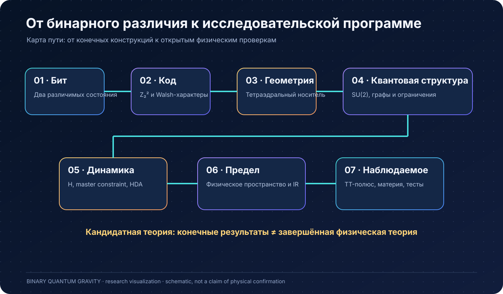


| Уровень | Что уже имеется | Чего не установлено |
|---|---|---|
| Бинарная геометрия | q=2-носитель, Walsh-тетраэдр, точная формула эффективной размерности | физическая универсальность и выбор природы |
| Квантовая геометрия | локальные Gauss-носители, SU(2)/Peter–Weyl, конечная PL-склейка | единая непрерывная физическая метрика из динамики |
| Канонические ограничения | точный master constraint и измеренные конечные Евклидовы HDA-карты | полный графоизменяющий лоренцев H и независимая off-shell HDA |
| Носители и спектры | W5, W17, W43, S₄ multiplicity, depth-6 frontier | ненулевое совместное ядро полного H |
| Уточнение | точные условные оценки, изометрии, intertwiner, chiral index | theory-specific физический continuum и rigging map |
| TT/EFT | six-Wilson basis/extractor, свободные positive controls | физический взаимодействующий TT-полюс и собственные коэффициенты |
| Физическая программа | определённый список критериев и внешних тестов | экспериментально проверенный новый закон природы |

Числа основной ведомости: **23 proved, 21 tested_finite, 4 conditional, 4 external_extension, 2 experimental_test, 1 no_go** (всего 55). Это реестр **утверждений с разной областью действия**, а не 23 взаимосвязанные доказанные физические аксиомы и не процент закрытия природы. В отдельной ведомости физикализации **все 9 физических условий остаются open_physical**.

## Ключевые теоремы и вычислительные результаты

### A. Вывод размерности 3 внутри замороженного бинарного правила

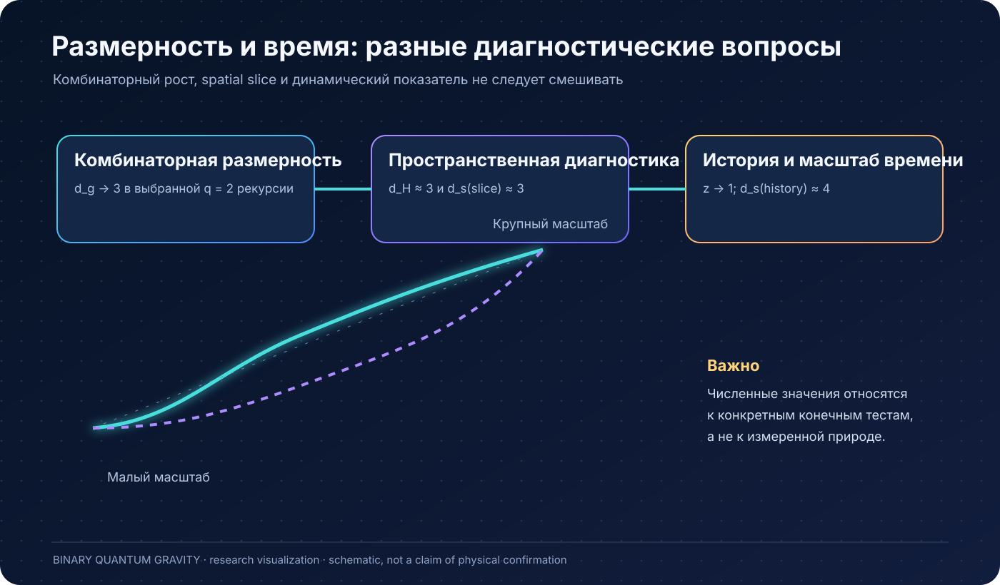


Уравнение выбора целого q (для `q≥1`) \(q+2=2^q\) имеет решение \(q=2\). Выбранный закон роста:

\[
N_g=\frac{4\cdot8^g+10}{7},\qquad
d_g=\log_2(N_g/N_{g-1})
=3+\log_2\left(1-\frac{35}{16\cdot8^{g-1}+40}\right)
\]

даёт \(d_g<3\), монотонное возрастание и \(\lim_{g\to\infty}d_g=3\). Это **точная комбинаторная теорема**, но только для выбранной q=2-рекурсии. Она не доказывает, что любое информационное пространство обязано иметь три измерения. См. [исходное доказательство](Q2_DIMENSION3_FIXED_POINT_CLOSURE.md).

### B. Тетраэдр без непрерывной подгонки

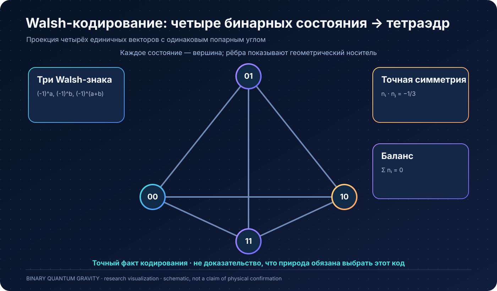


Четыре состояния \(\mathbb Z_2^2\) через три нетривиальных Walsh-характера дают

\[
n_{ab}=\frac{1}{\sqrt3}((-1)^a,(-1)^b,(-1)^{a+b}),
\quad
\sum n_{ab}=0,\quad n_{ab}\cdot n_{cd}=-\tfrac13\;\;((a,b)\ne(c,d)),
\]

\[
\sum_{ab}n_{ab}n_{ab}^{T}=\tfrac43 I_3.
\]

Полученный регулярный тетраэдр — математический факт кодирования. Через \(\rho_f=(I+n_f^i\sigma_i)/2\) он связывается с четырьмя face-qubit и Gauss-проекцией. Не следует автоматически называть такой носитель физическим пространством-временем. См. [Walsh bridge](MICRO_WALSH_QGEOM_BRIDGE.md).

### C. Исправленный graph-link SU(2)-носитель

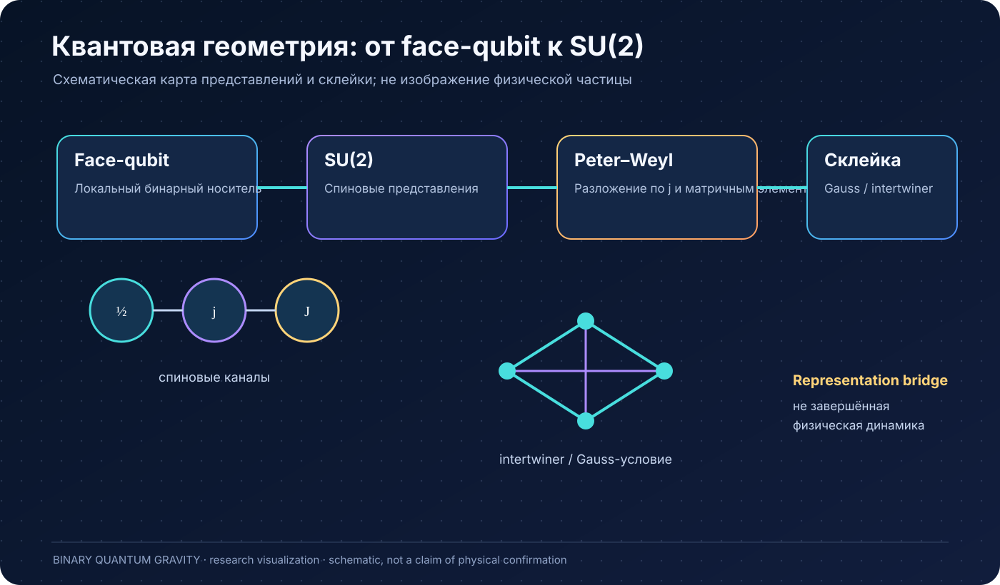


Четыре активных бинарных состояния не реализуют endpoint-bi-doublet \((2,2)\) как необходимое звено. При добавлении уже допустимого no-link/\(j=0\) состояния получается точная структура \(\mathbf5=(\mathbf2,\mathbf2)\oplus(\mathbf1,\mathbf1)\). Это конкретное преодоление no-go четырёхсостоянийного представления, а не обнаружение новой фундаментальной частицы. См. [Q2 graph-link/Peter–Weyl](Q2_GRAPHLINK_PETER_WEYL_BRIDGE.md).

### D. Глобальная геометрия и реконструкция Einstein-контроля

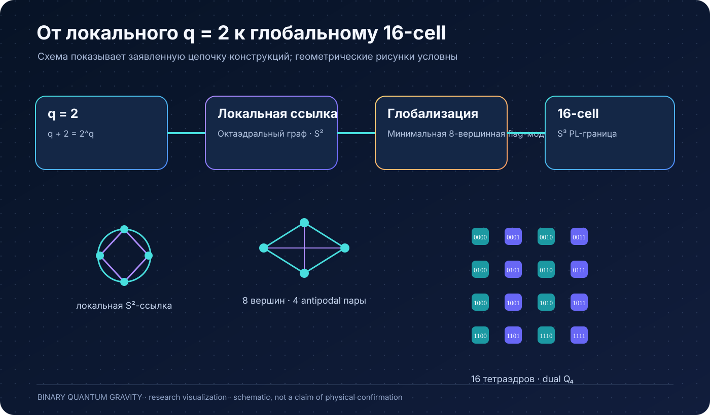


Рассматривается граница четырёхмерного кросс-политопа: **16 тетраэдральных клеток, 32 общие грани, дуальный граф Q4**. Показана согласованная finite PL-склейка и отмена ориентированных потоков на общих гранях. Отдельные конечные положительные и отрицательные контроли реконструируют B/simplicity/Urbantke-метрику и соединение в заданной геометрии. Сама эта реконструкция **не доказывает** самостоятельный низкоэнергетический вывод ОТО из полного гравитационного гамильтониана. См. [единый Einstein-контроль](QUBIT_TO_EINSTEIN_END_TO_END.md).

### E. Master constraint: точный математический принцип

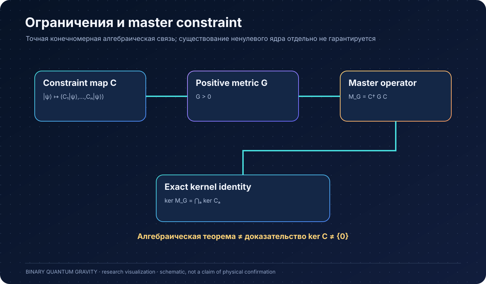


Для заданных конечных \(C_A\) и положительной матрицы \(G\):

\[
M_G=C^\dagger G C\ge0,\qquad
\ker M_G=\bigcap_A\ker C_A.
\]

Значит точный нулевой спектральный проектор существует, если нулевой сектор присутствует. Но теорема **не гарантирует \(\ker C\ne0\)**, единственности континуального предела или физического времени. См. [master projector](MASTER_CONSTRAINT_PHYSICAL_PROJECTOR.md).

### F. S₄ и TT: шесть физически независимых quartic структур

В выбранном generic directed-momentum parity-even on-shell S₄ TT-квотиенте классифицировано **6 независимых структур**; зарегистрированный six-Wilson extractor имеет определитель \(1/699840000\), и первые три направления высокой симметрии имеют недостаточный ранг. Это теорема о базисе **в заявленном EFT-классе**, не вычисленные микроскопические гравитационно-волновые коэффициенты. Сами \((c_1,\dots,c_6)_{\rm IR}\) и один физический масштаб остаются открытыми.

### G. Refinement, multiplicity и границы устойчивости

В \(Inv_{SU(2)}(V_j^{\otimes4})\) multiplicity \(S_4[2,2]\) равно \(\lceil2j/3\rceil\), поэтому с \(j=2\) логический сектор уже не единственен. Изолированное простое собственное значение multiplicity-оператора и зазор \(\gamma\) позволяют устойчивый выбор канала; на подходящих областях проектор меняется не более порядка \(2\|E\|/\gamma\). Выведены оценки refinement residual, включая утечку из носителя, и допустимые SU(2)-intertwiner с ancilla spin-1/2. **Ни одна** из этих оценок сама не устанавливает theory-specific физическую последовательность уточнений с ненулевой предельной физической формой.

### H. HDA: разница между finite relative-PASS и истинной алгеброй

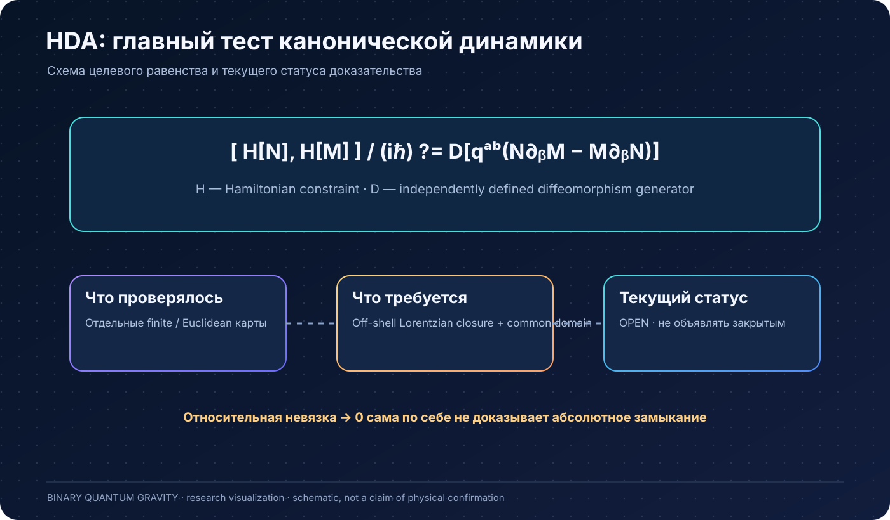


Полная HDA требует

\[
\frac{1}{i\hbar}[H[N],H[M]]
\stackrel{?}{=}D[q^{ab}(N\partial_bM-M\partial_bN)]
\]

с независимо определённым \(D\), общей областью операторов и контролируемой регуляризацией. Старые двух- и трёхузловые тесты подтверждают определённые относительные закономерности, **не полное off-shell замыкание**. Относительная невязка может стремиться к 0 при ненулевой абсолютной невязке, если нормировка \(D\) расходится.

Из настоящих E-only данных PL16 десять выходов \([E_0,E_r]\Omega\) имеют ранг 10 и \(\|C\|_F\simeq7.6084644\), \(\sigma_{\min}(C)\simeq1.3241893\). Для \(\mathcal R=(4/9)C+K\), если \(\mathrm{rank}K\le9\), \(\|\mathcal R\|_{\rm op}\ge(4/9)\sigma_{\min}(C)\simeq0.5885286\). Это **условное препятствие на одном конечном носителе**; реальный \(K\) со всеми S/R и независимым D не рассчитан.

### I. W5, W17, W43: спектры, ядра и ложные нули

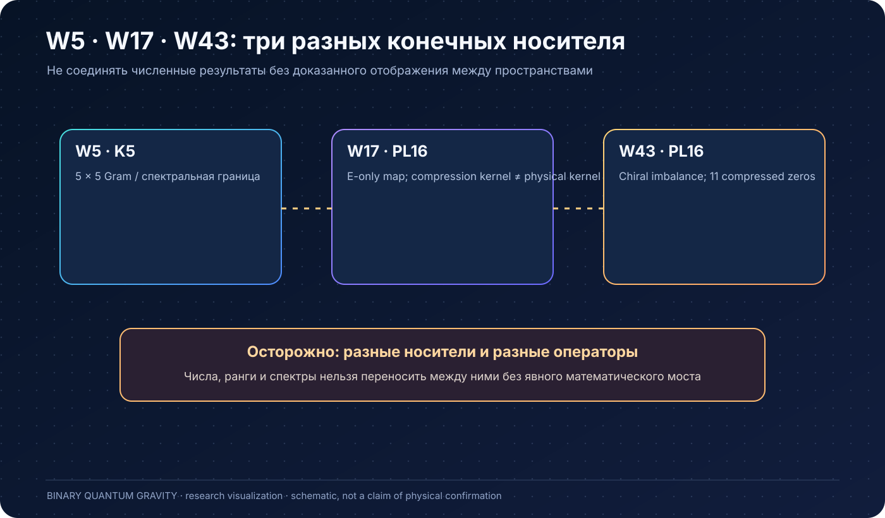


Для сохранённой комплексной \(5\times5\) матрицы \(G_{EE}=A^\dagger A\) на K5/W5 получено \(\lambda_{\min}\approx32.4135645\), \(\sigma_{\min}(A)\approx5.6932912\). На **точных напечатанных десятичных элементах** построен рациональный сертификат \(\lambda_{\min}>32.41356\); для исходных SU(2)-коэффициентов требуется оценка их численной погрешности. Если \(H=-2A/3+Q\), появление хотя бы одного ядра на том же W5 требует \(\|Q\|\gtrsim3.795527\). Для ядра размерности \(k\) существуют более строгие операторные/Frobenius нижние оценки через первые \(k\) сингулярных чисел A.

В PL16/W17 \(\mathrm{rank}(PE_0P)=2\) и \(\mathrm{rank}(E_0P)=17\), поэтому 15 нулей сжатия **не являются физическим ядром**. На \(K=\ker(PE_0P)\), \(\dim K=15\), полные выходы инъективно лежат вне W17; следовательно \(\dim \mathrm{span}(W17,E_0K)=32\). Из \(\sigma_{\min}(E_0P)\approx2.008139\) получена нижняя Frobenius-граница \(\|(I-P)E_0|_K\|_F\ge\sqrt{15}\cdot2.008139\).

В W43 чётный/нечётный хиральный дисбаланс 27/16 математически заставляет минимум 11 нулей **сжатой** хиральной матрицы; измерено ровно 11 и 16 противоположных пар ненулевых собственных значений. Это важная отрицательная диагностика против ложного объявления физических состояний.

**Не соединять численные нормы K5/W5 и PL16/W17/W43** без доказанного отображения между носителями.

### J. Depth-6: большой вычислительный фронтир

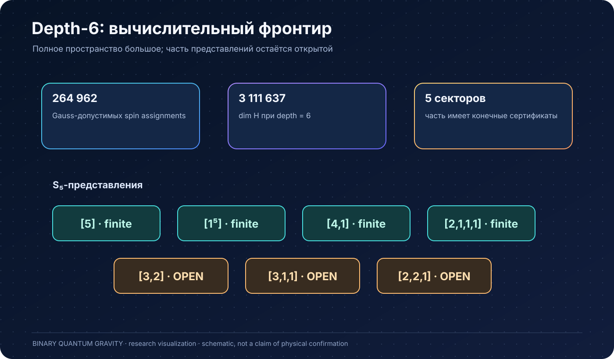


Gauss-допустимый набор — 264962 спиновых назначений; полная размерность \(\dim\mathcal H_{d=6}=3\,111\,637\). Конечные сертификаты зарегистрированы для \([5]\), \([1^5]\), \([4,1]\), \([2,1,1,1]\). Три S₅-представления \([3,2]\), \([3,1,1]\), \([2,2,1]\) имеют лишь структурное покрытие/частичные numerical witnesses и остаются открыты. Итог \(\ker M^{(d=6)}=\mathrm{span}\{|0\rangle\}\) **не доказан**. См. [depth6_frontier.json](depth6_frontier.json). Даже будущая finite theorem сама не даёт continuum gravity.

### K. Зарядовая ковариантность и precision: реальная численная проблема

Для одного выбранного K5 заряженного состояния сохранены 12 отдельных ориентированных \(H_E^{\rm sine}\)-расчётов (по 64 signed последовательности и 6144 примитивных ветвей). №0, №3, №6 помечены как cancellation dominated. В №6 отношение некогерентной квадрат-нормы к рассчитанной когерентной — порядка \(5.90\times10^{17}\); это не оценка ошибки, а показатель опасного сокращения. Одна лишь сумма скалярных норм разных ориентаций **не определяет** норму их комплексной когерентной суммы.

В V26 реализован независимый прямой алгоритм высокоточного сложения полных тензорных комплексных компонент, с проверками на точных двоичных рациональных входах и fail-closed ограничением памяти. Он устраняет ложный нуль на специально построенных тестовых данных, **но не исправляет неизвестную погрешность исходных SU(2) элементов**. Оригинальные физические ориентации 0/3/6 новой программой пока не пересчитаны.

### L. Лоренцев оператор: точная оставшаяся последовательность

Одна физическая лоренцева пара на PL16 требует **32 финальных комплексных V4-пути**, получаемых из 12 уникальных первых, 32 вторых и 32 третьих действий. V20–V22 создали схемы сохраняемых checkpoint и V2/V4 comparisons; в них выявлены и исправлялись ошибки порядка/порогов/метаданных. Это программная инфраструктура, **не доказательство вычисленных физических амплитуд**. В V26 новыми реальными финальными путями остаются **0/32**.

Необходимы: истинные 32/32 V4 и четыре независимо рассчитанных V2, комплексная сверка, затем физический \(H_L\) на общем носителе, \(H_E+H_L+R\), ненулевое совместное ядро и полный HDA-оператор с независимым D.

### M. Континуальный предел и физический TT

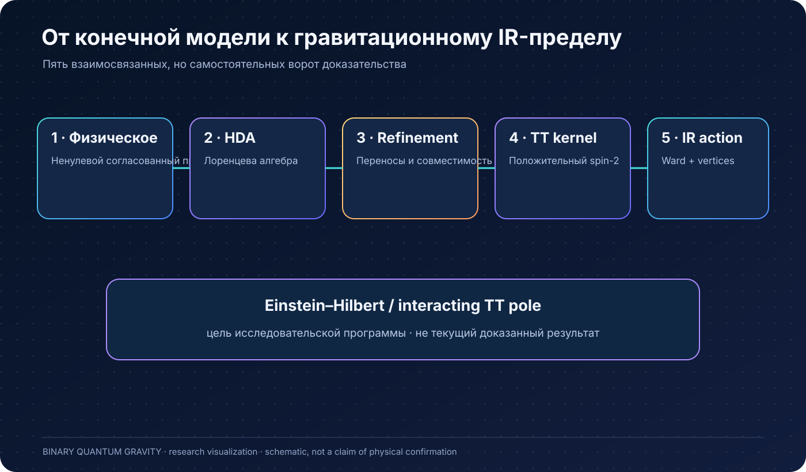


Разработана условная схема spectral projectors / rigging map при контролируемых master-зазорах, нормировках и вложениях. Эти условия ещё не выполнены для полного graph-changing семейства. Разделы о реляционной истории, \(Z[J]\to W[J]\to\Gamma\to K_{\rm TT}(\omega,k)\), свободном TT и Einstein–Hilbert являются математическими ориентирующими/положительными контролями. **Нельзя** приравнивать resolvent оператора ограничения к физическому гравитонному пропагатору без вывода времени и истории.

### N. No-go и ограничения интерпретации

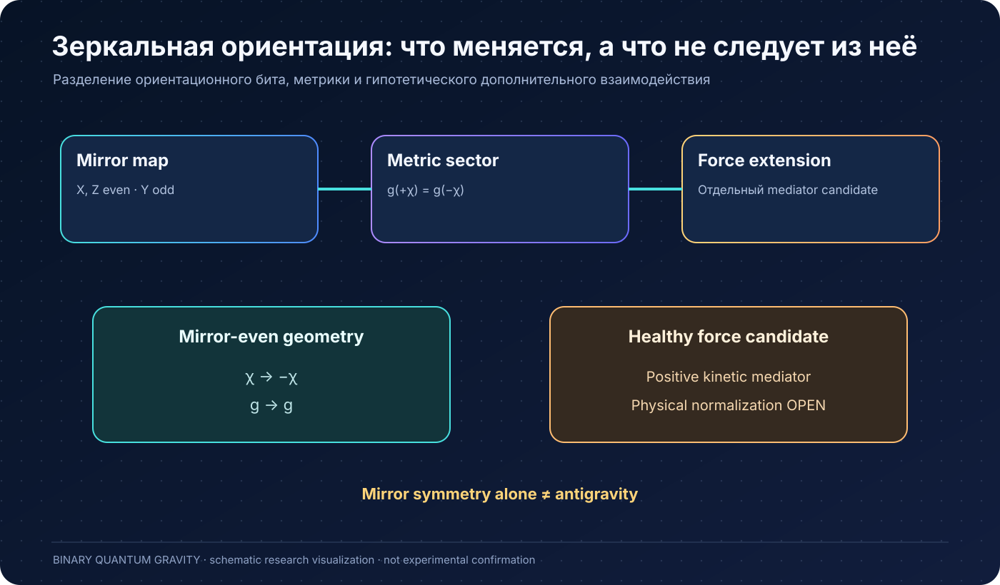


В репозитории имеется строгое ограничение на получение канонического S₄-equivariant \(j=1/2\to j=1\) refinement с чистой четырёхкубитной Gauss-singlet ancilla. Отдельные проверки показывают, почему положительный Gram нельзя напрямую отождествить с неопределённым GR kinetic tensor и почему конечная положительная самосопряжённая точная Sp(2,R)-тройка не может быть нетривиальной. Эти результаты запрещают конкретные неудачные пути, **не всю БКГ**.

## Ценность для науки и новые возможности

**Что можно использовать уже сейчас, при соблюдении лицензии и воспроизводимости:**

1. Компактные точные бинарные геометрические тестовые случаи для исследования связей информации, тетраэдральных потоков и квантовых носителей.
2. Вычислительные критерии ложных нулевых мод Galerkin-сжатий (хиральный индекс, leakage и полная карта на входном пространстве).
3. Проверяемые нижние границы норм и ранга необходимых компенсаторов в HDA, позволяющие отбрасывать заведомо недостаточные операторы до полного дорогого счёта.
4. Численные инструменты SU(2) graph-changing composition, SHA-связанных checkpoint и устойчивого когерентного сложения при сильном сокращении.
5. Схемы S₄-equivariant multiplicity selection / refinement и конкретные тестовые классы для представлений и tensor-network-style моделей.
6. Полный базис шести TT-квартетных on-shell структур для заданного symmetry class, позволяющий строить будущие предрегистрационные протоколы.

**Что может открыться только при успешном дальнейшем физическом выводе:**

- вычисляемая теория динамического появления метрики из бинарного микроскопического состояния;
- определённый континуальный физический проектор и взаимодействующий spin-2 сектор;
- независимые коэффициенты поправок к гравитационно-волновой дисперсии/двойному лучепреломлению;
- общие ограничения на космологию и линзирование, выведенные из одной физической history;
- строгие тесты возможного информационного сектора / инфотона.

Это **исследовательские перспективы**, не существующие приборы, открытые частицы, гарантированные будущие эффекты или подтверждённые космологические предсказания.

### Что здесь действительно может быть новым

Уже известные независимо формализмы (SU(2), Peter–Weyl, Regge, Plebanski, Urbantke, master constraints, Feshbach, TT EFT) не являются открытиями БКГ. Возможная оригинальность проекта — в **конкретном способе их интеграции** с выбранным q=2 route system, Walsh/PL носителем и набором вычислительных сертификатов, в том числе no-go и precision gates. Приоритет этих результатов относительно литературы пока не установлен независимым систематическим обзором и рецензированием. Научная новизна и физическая истинность — разные проверки.

## Дорожная карта от результата к физической теории

1. **C0: согласованная зарядовая ковариантность.** Высокоточно пересчитать 0/3/6 и когерентно сложить все 12 комплексных ориентаций до проекции, с доказанным бюджетом ошибки.
2. **C1: настоящий Lorentzian.** Получить 32/32 финальных V4-пути с общей исходной SU(2)-базой, проверкой V2 и всех 12 физических пар без потери фаз.
3. **C2: общее физическое ядро.** Построить полный \(H_E+H_L+R\) и master, учитывать полные выходы за W17/W43, доказать ненулевое ядро.
4. **C3: полная HDA.** Вычислить EE, ES, SE, SS, ER, RE, SR, RS, RR и сравнить с независимо выведенным D в одинаковом носителе/регуляторе, с абсолютными и относительными невязками.
5. **C4: continuum.** Контролировать refinement, домены, положительную физическую форму и независимость допустимых последовательностей.
6. **C5: физическая история и TT.** Из той же физической меры получить \(Z[J]\), 1PI, положительный massless interacting TT-полюс и Einstein IR.
7. **C6: слепой тест.** Заморозить шесть коэффициентов и общий физический масштаб до открытия независимых данных наблюдений.

## Воспроизводимость и права

- Канонические первичные реестры: [theory_gates.json](theory_gates.json), [physicalization_gates.json](physicalization_gates.json), [depth6_frontier.json](depth6_frontier.json), [THEORY_STATUS.md](THEORY_STATUS.md) и [AUDIT_CURRENT.md](AUDIT_CURRENT.md).
- Код: [scripts](scripts), [tests](tests), [proof_tools](proof_tools); версии V12–V26 размещены в отдельных исследовательских ветках, а не обязательно в main. **Смешивать исходники и checkpoint из разных коммитов без проверки нельзя.**
- Основные зависимости: `numpy`, `scipy`, `sympy`, `networkx`, `pandas`, `torch` из [requirements.txt](requirements.txt); `mpmath` дополнительно используется в V26.
- Публичная доступность файлов не равна свободной лицензии: [LICENSE](LICENSE) — **PROPRIETARY / All Rights Reserved** (© 2026 Evgeniy Koshtenko), с сохранением отдельно применимых сторонних прав.
- Научные результаты V22–V26 включают локальные программные регрессии, но эти счётчики не являются числом физических доказательств или независимых репликаций.
- Для отчётности требуется отдельно хранить Git SHA, хеши исходных матриц, состав Hilbert-базиса, точные параметры `Jmax`, принятый volume backend, погрешности и классификацию выводов.

### Гипотезы и специальные ветви

Инфотон, дополнительные пространственные измерения, 2T, mirror/chirality, conditional mirror-force, информационная космология и сценарии quantum foam остаются **модельными исследовательскими расширениями**. Их отдельные положительные контроли не доказывают новые частицы, антигравитацию, вторую временную координату или измеримые эффекты. Для каждого требуется собственный оператор, физическая нормировка, контроль ghost/унитарности, причинности и экспериментальных ограничений.

## Итог

> **BQG уже имеет полезные математические и вычислительные результаты и конкретную проверяемую программу физикализации. Но пока нет полного вывода реальной квантовой гравитации из исходной бинарной модели.** Наиболее ценный следующий шаг — реальные полные комплексные Lorentzian/SU(2) амплитуды, совместное ядро и безаномальная HDA, а затем физическая история и TT-полюс.

---


## Полный каталог утверждений основной ведомости

Этот перечень автоматически построен из сохранённого `theory_gates.json` ветки `main` на 09.11.2026. Метка `proved` относится **к заявленной области** соответствующего утверждения, а не к физической завершённости БКГ.

### Доказанные в своей области утверждения — 23

| Код доказательства/проверки | Зарегистрированное утверждение | Статус |
|---|---|---|
| `DIM3_FIXED_POINT` | For the frozen q=2 refinement count N_g=(4*8^g+10)/7, the finite-step dimension increases monotonically from below to the exact fixed point d*=3. | `proved` |
| `MICRO_WALSH_TETRA` | The three nontrivial Walsh characters of the frozen q=2 labels form an exact closed regular-tetrahedron flux frame and the declared qubit lift has exact Gauss-singlet geometry support. | `proved` |
| `MICRO_GLOBAL_GLUE` | On the selected 16-cell PL completion, q=2 face carriers glue exactly with Q4 dual graph, alternating orientation and pairwise shared-face flux cancellation. | `proved` |
| `Q2_GRAPHLINK_REP` | Four active q=2 states plus the graph-changing no-link singlet give the exact SO(5) (2,2)+(1,1) endpoint representation and factor the frozen q=2 Hamming adjacency through two graph-changing transporter steps. | `proved` |
| `LOGICAL_METRIC_JACOBIAN` | The logical X/Z shape doublet maps with exact rank two to orthogonal equal-norm trace-free tangents of the reconstructed tetrahedral metric, with the same intrinsic Jacobian on both orientation branches. | `proved` |
| `LHDA_COMP` | Under the explicitly stated fixed-cutoff habitat assumptions, composition gives cross/D=O(epsilon) and geometry-geometry/D=O(epsilon^2), reducing the full defect to the route defect in the regulator limit. | `proved` |
| `DEWITT` | Within the declared local two-derivative canonical ansatz, the DeWitt/HDA signature and degree-counting results identify the GR kinetic structure required by first-class closure. | `proved` |
| `S4_TT_QUARTIC` | The generic directed-momentum parity-even S4 quartic TT quotient has exactly six independent physical structures. | `proved` |
| `SIX_WILSON_EXTRACTOR` | The frozen 100/110/111/120 extraction system has full rank six and exact determinant 1/699840000; the first three high-symmetry directions alone have rank five. | `proved` |
| `NEAREST_BLOCK_S3` | A reciprocal face-sharing nearest-block transfer reduces to two symmetric 2x2 multiplicity matrices, giving six real amplitudes, and the regular tetrahedral stencil has the declared isotropic second and symmetry-resolved fourth moments. | `proved` |
| `ON_SHELL_WILSON` | Four-derivative terms proportional to the leading TT equation of motion are field-redefinition redundant on shell, leaving the physical quartic pole quotient six-dimensional. | `proved` |
| `FESHBACH` | For a specified Hermitian constraint operator and coarse carrier, the projected resolvent and K/A/B block-Krylov/Feshbach identities are exact. | `proved` |
| `REAL_GW_MAP` | A frozen six-Wilson TT pole response maps algebraically to the two polarization eigenvalues, alpha=4 modified-dispersion coefficient, velocity and phase observables. | `proved` |
| `REFINEMENT_PROJECTOR_STABILITY` | For finite positive master operators linked by an isometric refinement map, the physical-projector intertwining defect is bounded by the master intertwining residual divided by the minimum positive master gap. | `proved` |
| `CANONICAL_REFINEMENT_RESIDUAL` | For the canonical S4 [2,2] j=1/2 to j=1 isometry W, the refinement residual splits exactly into orthogonal carrier-leakage and internal-dynamical-mismatch terms, R=L+WD with R^dag R=L^dag L+D^dag D. | `proved` |
| `S4_LOGICAL_MULTIPLICITY` | For Inv_SU2(V_j^⊗4), the multiplicity of the S4 [2,2] irrep is ceil(2j/3); uniqueness holds only at j=1/2,1,3/2 and fails from j=2 onward. | `proved` |
| `MULTIPLICITY_CHANNEL_SELECTION` | An isolated simple eigenchannel of the S4 multiplicity matrix A_j selects a unique S4-covariant logical copy; its projector is stable under perturbations with norm bounded by 2\|\|E\|\|/gamma. | `proved` |
| `SCALE_FREE_REFINEMENT_RESIDUAL` | The physical-projector refinement defect is bounded by a scale-free master residual optimized over relative positive master normalization, yielding an invariant continuum diagnostic epsilon_sf. | `proved` |
| `SELECTED_CHANNEL_INTERTWINER` | Once consecutive S4 [2,2] multiplicity channels are nondegenerately selected, the inter-scale S4 intertwiner is unique up to phase and can be constructed by group averaging plus normalization. | `proved` |
| `CONSTRAINT_LEVEL_REFINEMENT_BOUND` | For matching Hermitian constraint families, one-hit constraint residuals bound the full master-refinement residual, reducing the expensive master comparison to single constraint applications. | `proved` |
| `TWO_SIDED_HABITAT_REFINEMENT` | Graph-changing refinement requires compatible embeddings of the base carrier and the one-hit constraint habitat; forward and adjoint residuals give an exact bound on the full master residual. | `proved` |
| `ANCILLA_PETER_WEYL_REFINEMENT` | No direct SU2 intertwiner V_j->V_{j+1/2} exists, but after adding one binary spin-1/2 strand the symmetric j+1/2 channel is selected by a unique SU2-equivariant inclusion/coisometry up to phase. | `proved` |
| `MICROSCOPIC_BILINEAR_REFINEMENT` | The correct microscopic q2 refinement object is the unique bilinear S4 intertwiner [2,2]_old x [2,2]_anc -> [2,2]_coarse; the committed gate verifies exact covariance and rank two. | `proved` |

### Воспроизводимые конечномерные проверки — 21

| Код доказательства/проверки | Зарегистрированное утверждение | Статус |
|---|---|---|
| `BITQ2` | Frozen q=2 binary-route train/held-out dimensional and observer-smoothing controls pass in the declared protocol. | `tested_finite` |
| `MAN3` | The selected q=2 cross-polytope PL completion is a recursive orientable 3-manifold completion with the declared link and homology checks. | `tested_finite` |
| `Q2EIN` | A single-data-path Euclidean control reconstructs B, simplicity, Urbantke metric, compatible connection and Einstein curvature from face-qubit data, with an independent non-Einstein negative control. | `tested_finite` |
| `L1_METRIC_PRECURSOR` | The certified L1 q4 six-edge S4 compression resolves E and T2 metric channels with lambda_E=1.1111917875584736, lambda_T2=1.0220278507464782, Delta_ET=0.08916393681199541 and mean-normalized relative_ET_split=0.08359564595312347. | `tested_finite` |
| `REGGEEH` | The implemented Regge/Einstein-Hilbert refinement controls reproduce the declared finite continuum-scaling relations on their test geometries. | `tested_finite` |
| `PLEBANSKI` | Finite simplicity/Urbantke/connection controls reconstruct the declared metric-sector quantities and distinguish Einstein from non-Einstein controls. | `tested_finite` |
| `PWGEO` | Finite Peter-Weyl SU(2) geometry, Euclidean Hamiltonian, volume/extrinsic-curvature and covariant composition gates pass within the declared cutoff domains. | `tested_finite` |
| `PW_MASTER32` | The nonlinear two-shell Peter-Weyl master normalization is applied on the complete 32D logical sector before environment tracing and its support-projector limit passes the finite control. | `tested_finite` |
| `PW_HIGHER_SHELL` | The completed 32D higher-shell Lambda is positive and non-scalar with lambda_min=10.635759878291307, lambda_max=15.059927665966466 and block-Lanczos reconstruction at approximately 1e-13 residual scale. | `tested_finite` |
| `PW_J1_S4` | The four-j=1 singlet space contains the multiplicity-one S4 [2,2] coarse doublet used as the representation-RG geometry carrier. | `tested_finite` |
| `ROUTE` | Independent dual-cell sharp, path-diffeomorphism and route-normal HDA principal-symbol gates pass on the declared probes. | `tested_finite` |
| `E2NODE` | The preregistered two-node Euclidean Peter-Weyl by route HDA regression exhibits the declared route, cross and pure-geometry scaling hierarchy without channel-dependent fitting. | `tested_finite` |
| `HDA_3NODE` | The frozen three-node graph-changing Peter-Weyl by route regression retains j=0 outputs and reproduces route~epsilon, cross~epsilon, pure-geometry~epsilon^2 and joint~epsilon scaling across all node pairs. | `tested_finite` |
| `LORENTZ` | The fixed real-beta Lorentzian coefficient control, spin-parity control and finite Peter-Weyl support bound pass through the declared regulator-safe window. | `tested_finite` |
| `JOINT_FIXED_INPUT` | For the frozen all-j=1/2 finite HH family the exact hit-depth theorem makes truncation inactive above Jmax=5/2 in the Euclidean calculation while the measured joint HDA defect decreases as epsilon^1.00644; the declared Lorentzian support wall is Jmax=13/2. | `tested_finite` |
| `REGGE_L6_HELDOUT` | The preregistered L=3,4,5 Regge TT residue continuation predicted the independently computed L=6 value with about 0.00714 percent relative error without refitting on L=6. | `tested_finite` |
| `TT_PROPAGATOR` | The reduced TT positive-control kernel has a massless leading pole, positive residue and the expected inverse-momentum equal-time covariance, with exact bare lattice correction controls in the declared model. | `tested_finite` |
| `TT_VACUUM` | The finite Gaussian TT vacuum two-point calculation reproduces the declared polarization covariance and equal-time scaling checks. | `tested_finite` |
| `J2_MULTIPLICITY_VOLUME` | At j=2 the first multiplicity-two S4 [2,2] sector is resolved by the existing absolute-volume operator into two distinct doubly-degenerate multiplicity channels, giving a symmetry-compatible geometric multiplicity basis without fitted projectors. | `tested_finite` |
| `J2_CONSTRAINT_MASTER_MULTIPLICITY` | The exact S4-twirled local Euclidean Peter-Weyl constraint master at j=2 has Schur form A2⊗I2 on the multiplicity-two [2,2] sector, with multiplicity eigenvalues 5.067680982953853 and 5.807713077901408 and gap 0.740032094947555; its preferred low channel is not aligned with the low-volume channel. | `tested_finite` |
| `SERIAL_MULTIPLICITY_MASTER_RG` | The same S4-twirled local Euclidean Peter-Weyl constraint master was evaluated at j=2,5/2,3,7/2,4; the lowest [2,2] multiplicity channel remains isolated at all five scales, with explicit A_j spectra and positive gamma_j. | `tested_finite` |

### Мосты с ещё не доказанными предпосылками — 4

| Код доказательства/проверки | Зарегистрированное утверждение | Статус |
|---|---|---|
| `PW_SYM_BLOCK_GROWTH` | Under the explicitly declared fully symmetric endpoint blocking, occupancy n=0..N supplies exactly the diagonal Peter-Weyl j=0,1/2,...,N/2 tower with correct dimensions and SU(2) Casimirs. | `conditional` |
| `SCALE_MAP` | Given one common positive action/length normalization lambda_R_eff, the repository maps dimensionless TT coefficients to one common microscopic length and physical modified-dispersion units without per-observable fitting. | `conditional` |
| `CORECERT` | The registered exact, finite-tested and explicitly conditional arrows compose into one internally closed candidate gravity package; conditional labels preserve their stated assumptions and do not imply experimental truth. | `conditional` |
| `JHALF_J1_RETURN_RG` | A symmetry-matched 32D j=1/2 to j=1 Peter-Weyl return-kernel RG comparison is implemented using the exact S4 [2,2] embedding; numerical verdict is tracked separately until the workflow artifact is produced. | `conditional` |

### Исследовательские расширения — 4

| Код доказательства/проверки | Зарегистрированное утверждение | Статус |
|---|---|---|
| `MICRO_DYNAMICAL_UNIQUENESS` | A stronger theorem could prove unique dynamical attraction from broad generic microscopic ensembles to the same Peter-Weyl geometric phase and blocking measure; this is not a blocker for the declared constructed candidate. | `external_extension` |
| `HDA_ARBITRARY_GRAPH` | A theorem uniform over arbitrary graph families, arbitrary held-out habitats and the full Lorentzian graph-changing domain would strengthen universality beyond the finite declared HDA package. | `external_extension` |
| `JOINT_UNBOUNDED_REFINEMENT` | A uniform theorem over unbounded graph size, collective spin and regulator refinement would strengthen the finite-word support and fixed-input joint-limit result. | `external_extension` |
| `UNIVERSALITY` | Testing broad alternative microscopic ensembles, compatible blocking maps and larger graph families can measure the universality class of the closed candidate without redefining its current core. | `external_extension` |

### Протоколы экспериментов — 2

| Код доказательства/проверки | Зарегистрированное утверждение | Статус |
|---|---|---|
| `BLIND_GW_TEST` | Freeze the theory commit, six-vector, common scale rule and likelihood before opening a held-out gravitational-wave dispersion/birefringence comparison. | `experimental_test` |
| `INDEPENDENT_REPLICATION` | Independently written implementations should reproduce the key exact and numerical certificates without importing the implementation under test. | `experimental_test` |

### Зарегистрированный отрицательный результат — 1

| Код доказательства/проверки | Зарегистрированное утверждение | Статус |
|---|---|---|
| `PURE_ANCILLA_NODE_REFINEMENT` | A fixed pure four-qubit Gauss-singlet ancilla cannot induce the canonical S4-equivariant j=1/2 to j=1 logical refinement map. | `no_go` |

## Девять обязательных физических условий

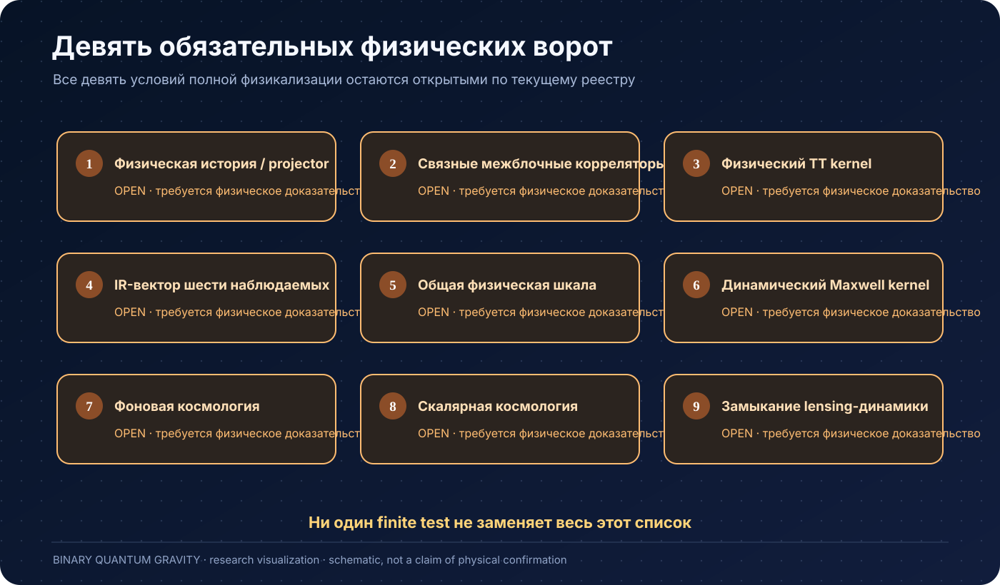


| № | Условие | Необходимое свидетельство | Статус |
|---|---|---|---|
| 1 | `PHYSICAL_PROJECTOR_HISTORY` | Construct the theory-specific anomaly/refinement-compatible rigging-map or boundary-history amplitude from the actual graph-changing gravitational constraint family, with a derived clock only if the microscopic construction supplies one. | OPEN |
| 2 | `CONNECTED_INTERBLOCK_HISTORY` | Compute connected multi-block/refinement metric cumulants with the theory-specific physical projector/history amplitude and remove vacuum-disconnected pieces through the generating functional. | OPEN |
| 3 | `PHYSICAL_TT_KERNEL` | Derive the continuum/IR physical metric 1PI Hessian and its TT projection K_TT(omega,k) from the theory-specific physical generating functional, recovering the leading massless Einstein/Fierz-Pauli pole before reading quartic corrections. | OPEN |
| 4 | `IR_SIX_VECTOR` | Freeze the six microscopic on-shell quartic TT Wilson coefficients from the derived physical TT pole without post-hoc reduction to a lower-dimensional ansatz. | OPEN |
| 5 | `COMMON_SCALE_CALIBRATION` | After the dimensionless physical outputs are frozen, derive one common physical scale internally or calibrate exactly one declared datum and hold that scale fixed for all remaining observables. | OPEN |
| 6 | `DYNAMICAL_MAXWELL_KERNEL` | Derive the theory-specific transverse photon 1PI kernel Gamma_AA^(2), Maxwell stiffness Z_A, massless deconfined photon pole and IR causal cone from the same connected physical history generating functional. | OPEN |
| 7 | `PHYSICAL_BACKGROUND_COSMOLOGY` | Derive the physical homogeneous Gamma_FLRW and its rho_hist(a), p_hist(a), H(a) and w_hist(a) from the same connected history measure, with w inferred only after rho is derived. | OPEN |
| 8 | `PHYSICAL_SCALAR_COSMOLOGY` | Derive the physical scalar metric kernel and stable Phi/Psi, growth, effective sound-speed and anisotropic-stress response from the same theory-specific effective action. | OPEN |
| 9 | `LENSING_DYNAMICS_CLOSURE` | Show that one derived scalar metric response simultaneously predicts massive-body dynamics, weak/strong/CMB lensing, Fermat/time-delay phase and coherent gravitational wave-optics, with no independent lensing or interference potential. | OPEN |

---

# Расширенный обзор базовых ветвей

**Исследовательская программа. Актуальный обзор: 12 октября 2026 года.**

BQG исследует возможность построить геометрию пространства-времени и гравитацию из минимальных информационных состояний. Главные идеи проекта: бинарная микроструктура; первичность информации; возможная информационная мода — **инфотон**, связанная с гравитоном; гладкая макроскопическая геометрия как результат усреднения дискретной структуры. Дополнительные пространственные измерения и вторая временная координата рассматриваются как две отдельные гипотезы расширения.

**Полный физический предел BQG не доказан.** Структурная замкнутость и физическая завершённость сейчас **false**. Девять обязательных физических условий остаются открытыми. В проекте есть точные математические результаты, конечные численные проверки, условные мосты и отрицательные результаты; ни один из этих классов не следует автоматически считать доказательством всей теории или экспериментальным подтверждением.

## Как читать результаты

| Метка | Значение |
|---|---|
| **Теорема** | Доказанное утверждение при явно заданных предпосылках и области определения |
| **Конечная проверка** | Воспроизводимый расчёт на выбранном графе/срезе; не доказательство предела |
| **Условный мост** | Заключение доказано, но необходимые предпосылки для BQG ещё открыты |
| **Гипотеза** | Предложенная физическая конструкция, требующая вывода и проверки |
| **Открыто** | Необходимое звено пока не установлено |
| **Запрет / отрицательный результат** | Ограничение конкретного класса моделей; его область нельзя расширять без доказательства |

Машинные реестры сохраняют собственный словарь статусов. Исторические декларации замкнутости не имеют приоритета над актуальными свидетельствами. [Текущий аудит](AUDIT_CURRENT.md), [физические условия](physicalization_gates.json), [структурные условия](theory_gates.json), [реестр глубины 6](depth6_frontier.json).

## Информация и бинарная микроструктура

Исходная гипотеза: на минимальном уровне геометрия описывается информационными степенями свободы с бинарными состояниями. Классический бит, квантовый кубит, SU(2)-представление и физическая частица — разные понятия. Квантовое пространство состояний, правило вероятностей и динамику требуется задать или вывести; слово «бит» само по себе их не определяет.

В проекте построены $q=2$ носители, Walsh-тетраэдральные структуры и конечные геометрические реализации. Dimension-three fixed point установлен внутри заданного правила построения; это не доказательство единственности трёхмерного пространства среди всех информационных систем. Бинарные носители являются основой конкретной конструкции, а не универсальным доказательством минимальности природы.

## От носителя к квантовой геометрии

Локальная SU(2)-геометрия использует потоки, интертвинеры и Gauss-инвариантные состояния. Четыре spin-1/2 имеют двумерный синглетный сектор, который можно использовать как геометрический кубит. Peter–Weyl-представление, состояния отсутствующего ребра и graph-changing операции позволяют обсуждать изменение графов и спинов.

Глобальная PL-склейка и согласование общих граней — отдельные условия: локальная изометрия не гарантирует глобальной физической динамики. Дуальный граф Q4 границы четырёхмерного кросс-политопа описывает трёхмерную триангуляцию и сам не вводит дополнительную пространственную координату.

Мосты «кубит → B-поле → Urbantke-метрика → Einstein», Plebanski/simplicity, Regge и Einstein–Hilbert дают геометрические ориентиры и условные конструкции. Полная гравитационная мера, физический выбор сектора и перенос от бинарных операторов остаются самостоятельными обязательствами.

## Ограничения и физическое пространство

Нужны единообразно определённые Gauss-, диффеоморфные и полные лоренцевы гамильтоновы ограничения, согласованные объём, ориентации, домены и порядок операторов. После изменения объёма необходимо пересчитывать оба $H_E$ и $H_L$, включая промежуточные состояния.

Основной вычислительный барьер: полные прямые и сопряжённые образы $H_L$, обе чётности, все узлы и выходные состояния. Частичные ветви и сжатые матрицы не являются полными колонками. Последовательные $H_0H_1$ и $H_1H_0$ нужно сравнивать с диффеоморфным ограничением при одинаковом размазывании.

Для конечного полного семейства с положительной метрикой ограничений точен результат

$$
\begin{aligned}
M &= C_A^\dagger G^{AB}C_B \ge 0, \\
\ker M &= \bigcap_A \ker C_A.
\end{aligned}
$$

Он не гарантирует ненулевого совместного ядра и не выбирает предельное физическое скалярное произведение. Сжатие может создать ложные нули либо скрыть настоящий kernel. Алгебра деформаций гиперповерхности (HDA), структурные функции и отсутствие аномалий должны проверяться независимо.

Глубина 6 остаётся открытой: необходимы свидетельства для [32], [311], [221]. Учёт фронтира и успешный структурный поиск не заменяют сертификат ранга.

## Ненулевой согласованный предел

Для спектральных проекторов и вложений тестового пространства рассматривается

$$
\begin{aligned}
E_n &= \mathbf{1}_{[0,\delta_n]}(M_n), \\
\eta_n(\psi,\phi)
&= \frac{\langle E_n I_n\psi,E_n I_n\phi\rangle}{a_n}, \\
\eta_n(\Omega,\Omega) &= 1.
\end{aligned}
$$

Условный математический мост: если нормированные тестовые диагонали ограничены, master-форма контролирует каждое ограничение с коэффициентом $\kappa_{i,n}>0$, $\delta_n/\kappa_{i,n}\to0$ и нормированные ошибки переноса исчезают, то диагональный выбор подпоследовательности даёт ненулевую положительную предельную форму, обнуляющую ограничения. Факторизация по её нулю и завершение дают физическое гильбертово пространство.

**Это ещё не теорема физического предела BQG:** перечисленные предпосылки не установлены для её полного семейства. Единственность, независимость уточнений, домены и согласованность наблюдаемых требуют отдельных доказательств. Нормировка сама не даёт ограниченности; подпоследовательность сама не даёт единственности.

## Физическая история и наблюдаемые

Необходима связь физического пространства с реляционным временем и физическими амплитудами. Конечные Page–Wootters/history-модели показывают возможность условной эволюции, но их часы и гамильтонианы заданы извне.

Рабочий порядок: физическая форма/история → источники Z[J] → W[J] → связные геометрические корреляторы → частотно-зависимый отклик и эффективное действие. Спектральный параметр master-оператора не является физической частотой, а его resolvent не становится гравитонным пропагатором без этого вывода.

## Дискретность, гладкость и синусы

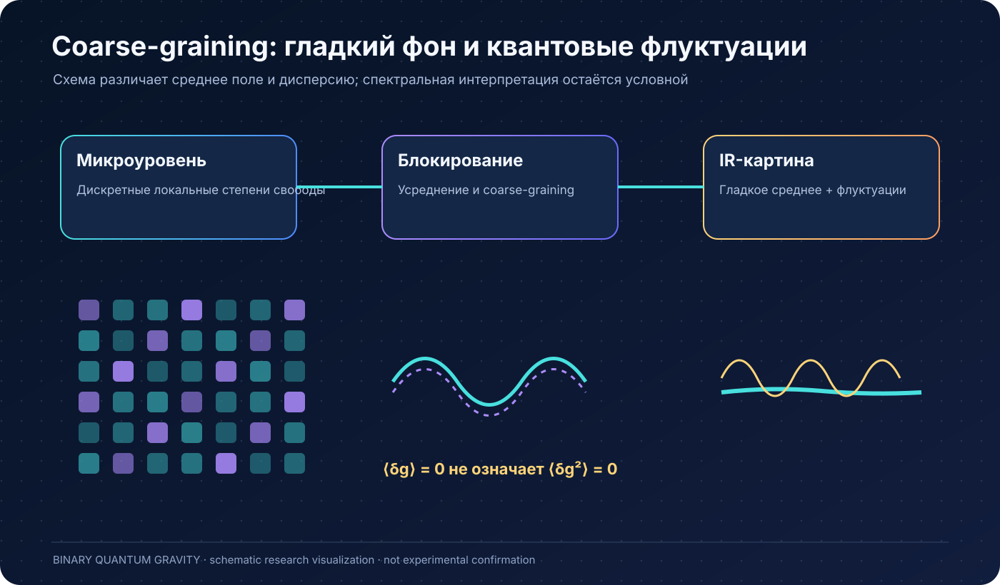


Аналогия со стеной формулируется через **разрешение**: микроскопическая структура сохраняется, но при $L\gg a$ становится неразличимой. Расстояние до наблюдателя может ухудшать разрешение; геометрия не обязана физически меняться от расстояния. Для масштабного предела необходимо окно $a\ll L\ll R$ и семейство уточняемых областей.

У свободного положительного соседнего решёточного гамильтониана

$$
\begin{aligned}
\omega_a^2(\mathbf{k})
&= \frac{4c^2}{a^2}\sum_i \sin^2\!\left(\frac{k_i a}{2}\right), \\
S_a(\mathbf{k}) &= \frac{\hbar}{2\omega_a(\mathbf{k})}.
\end{aligned}
$$

Здесь S выведен из вакуума **этой выбранной модели**. Гауссово усреднение в бесконечном объёме даёт

$$
V_a(L)=\frac{\hbar}{8\pi^2cL^2}
\left[1+\frac{a^2}{40L^2}+\mathcal{O}\!\left(\frac{a^4}{L^4}\right)\right].
$$

Численная квадратура подтверждает ведущий коэффициент $1/40$. При $L=100a$ ведущая поправка дисперсии к гладкому результату — $2.5\times10^{-6}$. RMS убывает как $L^{-1}$. В другой, короткокоррелированной гауссовой модели RMS убывает как $L^{-3/2}$; различие определяется спектром, а не противоречием.

Нулевая мода безмассового поля конечного тора не имеет нормируемого осцилляторного вакуума и должна обрабатываться явно. Квадрат центральной производной $\sin(ka)/a$ имеет дополнительные нули; это другой оператор, чем соседний $D^\dagger D$. При дискретном времени центральная схема требует контроля CFL, $c\Delta t/a\le1/\sqrt{3}$ в 3D.

Сглаживание умножает коррелятор на аналитический фильтр: не создаёт отсутствующий spin-2 полюс и не исправляет отрицательную спектральную норму. [Полный вывод, код и результаты](docs/information_infoton_review/sine_correlations/DERIVATION_RU.md).

## Гравитон и гравитационный IR-предел

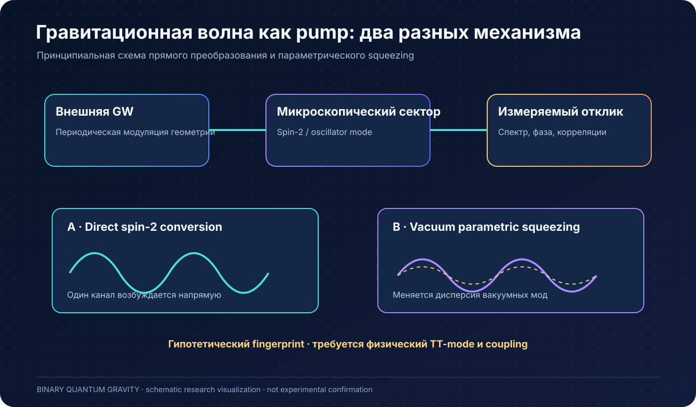


Нужны положительный взаимодействующий TT-полюс, две физические поляризации в 3+1, диффеоморфные Ward-тождества, локальность и контролируемое разложение. Свободная TT/Fock-модель является ориентиром, а не результатом полной BQG-истории. Внутренний SU(2)-спин не равен автоматически пространственно-временному спину.

При доказанных предпосылках локальной метрической динамики ведущая двухпроизводная часть классифицируется как Einstein–Hilbert, с возможным космологическим членом и выбранной нормировкой. Это условное утверждение о ведущем IR-секторе. Оно не устанавливает всю UV-теорию, высшие вершины, материю и космологию.

## Инфотон и его связь с гравитоном

Инфотон — предложенная информационная степень свободы. Пока не определено, является ли он фундаментальным регистром, коллективной модой или независимой частицей. Предложение о его первичности сохраняется как гипотеза; название не является доказательством существования.

Историческая ветка инфотона восстановлена для аудита. Четыре spin-1/2 дают $2\times(j=0)\oplus3\times(j=1)\oplus1\times(j=2)$, но локальные $j=0$ и $j=2$ ортогональны. Старые экстремальные состояния $j=2$ не являются Gauss-синглетами. Это препятствие конкретному локальному отождествлению, а не запрет коллективного гравитона на многих узлах.

Физический критерий связи: вывести из одной истории матрицу корреляторов I и $h_{\mathrm{TT}}$; полюсы и ранг их остатков различат два оператора одной моды и дополнительную частицу. Простой постоянный массовый mixing с матрицей $\begin{pmatrix}0 & g \\ g & M^2\end{pmatrix}$ и положительной кинетикой при $g\ne0$ нестабилен ($\det=-g^2$). Стресс-тензорные, производные и gauge-завершённые взаимодействия требуют отдельного анализа. Модельный Mathieu-резонанс воспроизведён, но его связь и частота не выведены из BQG.

[Обзор инфотона и восстановленные расчёты](docs/information_infoton_review/REVIEW_RU.md).

## Дополнительные измерения и 2T

**Пространственная ветка:** требуется вывести координаты, компактность/радиус, спектр дополнительных мод, физические операторы и амплитуды переходов. Безмассовый spin-2 в $D=4,5,6$ имеет соответственно 2,5,9 поляризаций. Дополнительные низкоэнергетические векторные/скалярные моды нужно учесть либо подавить.

**2T-ветка:** требуется родительская система, полные Sp(2,R)-ограничения, устранение отрицательных норм и положительная физическая редукция. Конечная положительная система с точными самосопряжёнными Sp(2,R)-коммутаторами допускает только нулевую тройку: цикличность $\mathrm{Tr}(Q_{11}[Q_{11},Q_{12}])$ и $[Q_{11},Q_{12}]=2i\hbar Q_{11}$ дают $\mathrm{Tr}(Q_{11}^2)=0$. Бесконечномерный предел требует контроля областей определения. Неэрмитова конечная матричная sl2-реализация не является положительной квантовой 2T-физикой.

Калибровочные 2T shadows не равнозначны наблюдаемому путешествию во вторую временную координату. Обе гипотезы остаются открытыми расширениями, а не доказанными свойствами core.

## Информационная геометрия, причинность и уточнение

В проекте исследуются entangled gluing, XX/free-fermion модели, критические и gapped режимы, QFI-проводимость, метрика сопротивлений, spectral dimension и топологические различители. Ориентированный объём и точные результаты ограничены заданными носителями. Скалярная mutual information не задаёт универсально геометрическое расстояние; отрицательные topology-free тесты сохраняются.

Динамическое расстояние, operator front и propagation cone установлены в конкретных моделях. Один физический projector не определяет причинность: нужна динамика. Multiplicity-space selection, S4-каналы, ancilla и межмасштабные карты исследуют уточнение. Невозможность выбранного прямого spin-refinement или pure-ancilla ansatz не является запретом всех уточнений. [Предыдущий подробный обзор](docs/archive/README_BEFORE_SYNTHESIS_2026-10-12.md) сохраняет эти направления и их источники; исторические статусы нужно читать вместе с текущим аудитом.

## Компактные голономии, материя и космология

Семь загруженных пакетов включены с отдельными пространствами имён: общие A1–A32, LIN23, GRAPH24 и STAGE2. Поздний номер версии не означает, что одна модель включает другую. Синусные операторы, конечные gauge-модели, topology/chiral/quantum проверки и классические ADM-ориентиры полезны для независимых контролей.

В reduced holonomy ansatz $f_1=\sin^2(\delta K)/\delta^2$ согласование даёт $\beta=\cos(2\delta K)$: знак может меняться. Синусы сами не гарантируют лоренцеву гиперболичность. A48 MODEL_FAIL сохраняется; отсутствующие зависимости и ошибочные критерии старых артефактов перечислены в [интеграционном отчёте](docs/compact_holonomies/INTEGRATION_RU.md), [реестре](docs/compact_holonomies/EVIDENCE_REGISTRY.json).

Maxwell/фотон, lensing, фоновая и скалярная космология, чёрные дыры и shadow-action остаются отдельными физическими задачами. Конформный/скалярный obstruction не снимается подстановкой фонового FRW. Шесть квартовых TT-наблюдаемых и observable translator не заменяют физический вывод коэффициентов.

c, ℏ, G задают планковские масштабы; подстановка измеренного G калибрует действие, но не доказывает его происхождение. Безразмерную α нельзя вывести сменой единиц. Информационно-графовые формулы масс/констант и «слепые» предсказания остаются отдельными гипотезами: нужны размерностная нормировка, независимая фиксация параметров и заранее заданные критерии проверки. Совпадения и подгонки не повышают статусы BQG.

## Пять маршрутов к доказательству

| Маршрут | Что требуется установить | Роль |
|---|---|---|
| **1. Спектральное физическое пространство** | Полные ограничения, нормированные переносы, ненулевой и согласованный предел | Первая основная преграда |
| **2. Каноническая HDA** | Настоящие последовательные действия, структурные функции, отсутствие аномалий | Независимый контроль динамики |
| **3. Holonomy/BF/Plebanski/Regge** | Simplicity, мера, физический сектор и предел | Альтернативная конструкция |
| **4. История и масштабные корреляции** | Физическое состояние/время, связные корреляторы, locality и уточнение | Мост от пространства к наблюдаемой динамике |
| **5. Interacting TT и Ward** | Положительный spin-2, вершины, симметрия и ведущий локальный IR action | Условный выход к Einstein–Hilbert |

Наиболее обоснованная последовательность **1 → 4 → 5**, с маршрутом 2 как независимой проверкой. Ранжирование основано на зависимостях и уже имеющихся конструкциях; доказанного сравнения общего времени нет. Дополнительные измерения и инфотон не должны подменять основные условия.

[Подробный план с критериями завершения и остановки](PROOF_ROADMAP_RU.md).

## Свежая проверка и воспроизводимость

Пересмотр доступной истории: 121 ветка, 111 различных голов, 1969 достижимых коммитов, 2073 уникальных файловых blob. Все удалённые головы совпали с локальными remote refs. Из 756 исторических Python-версий 755 проходят AST; ошибка одной старой версии не означает ошибку текущего файла. Это статический учёт, не полное повторение всех архивных вычислений.

Пять геометрических/квантовых core-скриптов в целевом повторе завершились с exit=0. Первоначальный отказ `k5_quantum_geometry_bridge` объяснён ложным ростом ранга при абсолютном пороге на ненормированных степенях Wilson-матрицы. Исправление использует нормированные столбцы и относительный SVD-порог: конечный запуск теперь имеет `passed=true`, ранг 1 и остаток $1/91$. Это floating-point контроль, не точный сертификат ранга и не доказательство BQG.

[Последнее численное продолжение и переносимые данные](docs/numerical_continuation/README_RU.md): завершены 26/26 внутренних HE-образов и 16/16 компонент CK одного нового входа. Выбранный слабый обратный элемент согласован с прежним сопряжённым элементом с расхождением около $1.94\times10^{-16}$. Это проверка при primitive-adjoint identities, а не полная прямая reverse-колонка. Для второй стадии подготовлены 96 входов; вычислены 50 из 352 канонических HE-входов её прямой части. Полный бюджет ошибок и физический предел остаются открытыми.

Минимальные воспроизводимые команды из корня репозитория (Python с NumPy; дополнительным скриптам могут требоваться SciPy/SymPy и другие зависимости):

```bash
python -m unittest discover -s tests -p test_audit_status.py
python scripts/verify_sine_bridge.py --output /tmp/bqg_sine_gate.json
python docs/information_infoton_review/sine_correlations/calculate.py
python docs/information_infoton_review/check_hypotheses.py
```

Последние две команды обновляют JSON рядом со своими файлами. Эти проверки подтверждают только описанные области применимости. Архивные программы могут иметь отдельные или недостающие зависимости; универсальная воспроизводимость всей истории не заявляется.

## Девять обязательных физических условий

Физическая история/projector; связная межблочная история; физический TT kernel; IR-вектор шести наблюдаемых; общая физическая шкала; динамический Maxwell kernel; фоновая космология; скалярная космология; замыкание lensing-динамики. Все обязательны для объявленной полной физикализации и остаются открытыми в [physicalization_gates.json](physicalization_gates.json).

Доказательство гравитационного IR-предела — более узкая цель, чем завершение всех девяти условий. Проверка должна учитывать весь обязательный список; неполный агрегатор не имеет права объявлять всю теорию завершённой.

## Навигация

- [Текущий научный аудит](AUDIT_CURRENT.md), [исторический реестр статусов](THEORY_STATUS.md).
- [Аудит инфотона и обеих размерностных гипотез](docs/information_infoton_review/REVIEW_RU.md), [состояние свидетельств](docs/information_infoton_review/EVIDENCE_STATUS.json).
- [Синусная динамика и корреляции](docs/information_infoton_review/sine_correlations/DERIVATION_RU.md).
- [Семь пакетов компактных голономий](docs/compact_holonomies/INTEGRATION_RU.md).
- [Архив предыдущего подробного README](docs/archive/README_BEFORE_SYNTHESIS_2026-10-12.md).

**Цель — вывести наблюдаемую гравитацию из информационной микроструктуры. Текущий результат — исследовательская конструкция с проверяемыми конечными моделями и явно открытым физическим пределом.**


---

**Историческая научно-популярная версия с 33 уроками и mirror/chirality-ветвями:** [архивное повествование](docs/README_STORY_ARCHIVE_20261109.md). Её гипотезы и заявленная область доказанности должны сверяться с актуальными машинными реестрами.
